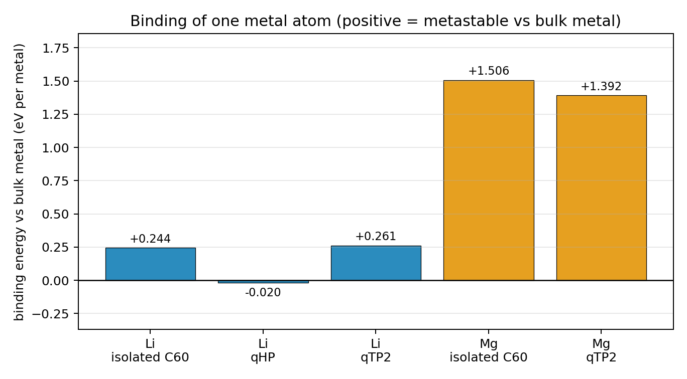
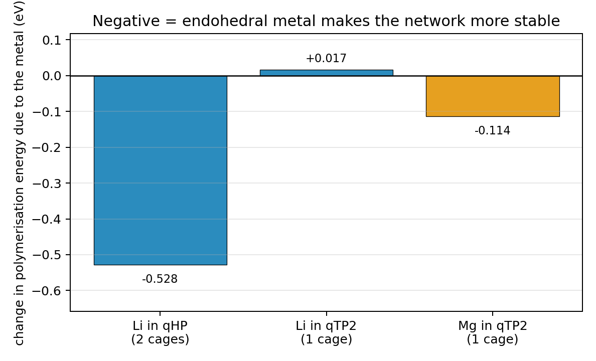
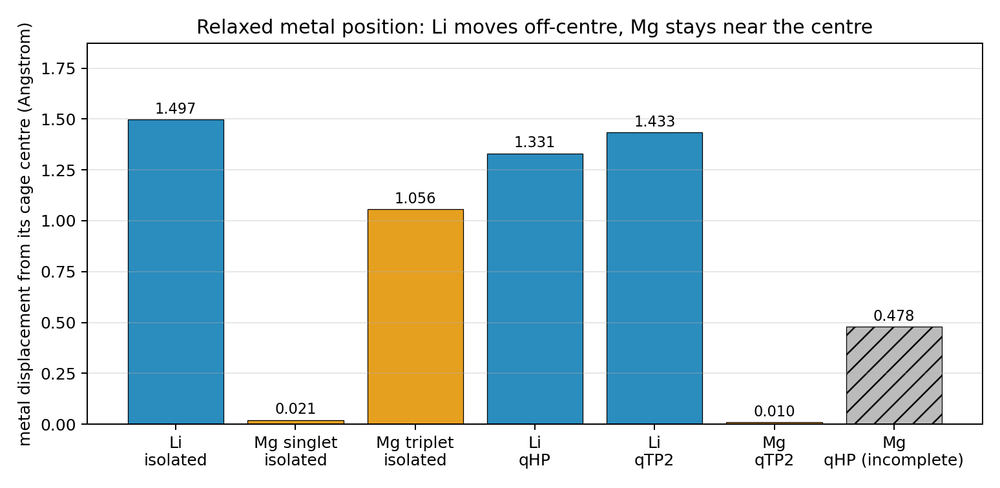

# Pilot results, 2026-11-18: Li and Mg inside C60, qHP and qTP2 networks

**A first end-to-end test of the corrected endohedral workflow: off-centre starts, fixed spin states, isolated cage and 2D networks**

Version 1.0 — 18 November 2026

Related material: the audit of the earlier 32-metal screen and the network feasibility assessment are in
[../../report/endohedral_c60_network_feasibility_report.md](../../report/endohedral_c60_network_feasibility_report.md).
The input definitions are in [../docs/original_README.md](../docs/original_README.md).

---

## 0. Summary

Twelve VASP calculations were run: Li and Mg inside an isolated C60, inside the qHP network and inside the
qTP2 network, plus the five reference calculations (C60, qHP, qTP2, bulk Li, bulk Mg). Eleven finished
normally. The qHP Mg run (case 05) was cancelled and is not converged.

**Update (2026-11-21).** The missing qHP Mg calculations and the [Li@C60]+ calibration have
been completed in round 2: see
[../../round2_2026-11-19/report/round2_2026-11-19_results.md](../../round2_2026-11-19/report/round2_2026-11-19_results.md).
The qHP Mg ground state is non-magnetic, both Mg atoms sit at the cage centres, and Li+ is
off-centre by 1.479 Å.

The pilot answers the two questions that the earlier 32-metal screen could not answer:

1. **The method fix works.** With an off-centre start, Li moves further off-centre to a displacement of
   1.497 Å in the isolated cage and 1.33-1.43 Å in the networks, with a Li-C distance of 2.17-2.26 Å,
   while Mg relaxes back to the cage centre (0.02 Å in the isolated cage, 0.01 Å in qTP2). The earlier
   centre-start screen would have reported both metals as "converged at the centre". They are not the same.
2. **The networks survive one metal per cage.** In all completed network runs the carbon framework keeps
   every bond of the pristine reference (188 C-C bonds for qHP, 94 for qTP2; every carbon stays
   three- or four-coordinated; the longest C-C bond is 1.62 Å). The vacuum axis stays at 25.0 Å and the
   in-plane cell changes by less than 1.1 percent. The final in-plane stress is below 0.5 kB in every
   completed network run.

The first energetics are also informative, but they are not yet quantitative enough to rank metals:

- Li inside the qHP network is essentially thermoneutral with respect to bulk Li (-0.020 eV per Li),
  while Li inside an isolated C60 (+0.244 eV) or inside qTP2 (+0.261 eV) is metastable by about a quarter
  of an eV.
- Mg is metastable with respect to bulk Mg by about 1.4-1.5 eV in both the isolated cage and qTP2.
- Li makes polymerisation of the qHP network more favourable by 0.53 eV per two cages; Mg makes qTP2
  polymerisation more favourable by 0.11 eV per cage; Li on qTP2 is neutral (+0.02 eV).

These numbers carry three caveats that are discussed in Section 5: the bulk-metal references include
D3(BJ) dispersion and are not fully converged, no free-atom references were calculated, and the qHP
reference structure is the older ring-opened model, which is only 0.13 eV per two cages below isolated C60.
The qualitative result (Li off-centre, Mg centred, networks intact) is robust; the energy ranking needs
the follow-up in Section 6 before it is used to select metals.

---

## 1. Calculations and completion status

Twelve folders, one structural optimization each, all with PBE + D3(BJ), ENCUT 520 eV, spin polarisation
and ISYM = 0. The isolated and network runs were started with the metal 1.0 Å (isolated cage) or 0.8 Å
(networks) away from the cage centre, and with every carbon randomly displaced by 0.02 Å, so that no
inversion centre survives.

Completed (11): 01, 02, 03, 04, 06, 07, 08, 09, 10, 11 and 12.
Not completed (1): 05 (qHP Mg), cancelled after 20 h 45 min. Its final force is 1.64 eV/A and its
in-plane stress is 2.9 / 1.8 kB, so neither its energy nor its geometry is converged. It is kept in the
data set for provenance but excluded from the energy analysis.

The complete run table, generated from data/pilot_summary.csv, is in Appendix A.

---

## 2. Settings

- **Functional and basis:** PBE, PAW, ENCUT 520 eV, D3(BJ) dispersion (IVDW = 12), PREC = Accurate,
  LASPH = .TRUE., LREAL = .FALSE., ADDGRID = .TRUE.
- **Isolated cage:** 22 Å cubic box, C60 at the centre, Gamma point, fixed spin state with NUPDOWN and
  an initial moment on the metal, SIGMA = 0.005 eV, EDIFF = 1E-5, EDIFFG = -0.02 eV/Å.
- **Networks:** qHP cell with 120 C and two metals (one per cage), qTP2 cell with 60 C and one metal.
  c = 25.0 Å fixed (vacuum along z), only a and b relax (ISIF = 3 with
  LATTICE_CONSTRAINTS = .TRUE. .TRUE. .FALSE.), dipole correction along z (IDIPOL = 3),
  SIGMA = 0.05 eV, k-mesh 4x3x1 (qHP) or 4x4x1 (qTP2), EDIFF = 1E-5, EDIFFG = -0.02 eV/Å.
- **Bulk metals:** primitive cells, symmetry on, KSPACING 0.12, Methfessel-Paxton smearing 0.1 eV,
  EDIFF = 1E-5, positive EDIFFG = 1E-4 eV (energy criterion, because forces vanish by symmetry).
- **POTCARs:** C, Li and Mg from PAW_PBE_54, identical for every run of the same element. POTCAR files
  are not included in this repository (VASP licence); the dataset names are in each POTCAR_SPEC.

The isolated C60 reference (08), the qHP reference (09), the qTP2 reference (10) and the bulk references
(11, 12) were recalculated with exactly these settings, so the energy differences below are consistent.
They must not be mixed with the PBEsol or no-D3 energies of the earlier network work.

---

## 3. Results

### 3.1 Method calibration: Li moves, Mg stays

The isolated-cage runs reproduce the expected contrast between the two metals.

| Case | Final metal position | Moment |
|---|---|---|
| 01, Li in isolated C60 | 1.497 Å from the cage centre; Li-C minimum 2.26 Å | 1.000 uB |
| 02, Mg in isolated C60, singlet | 0.021 Å from the cage centre; Mg-C 3.54-3.58 Å | 0.000 uB |
| 03, Mg in isolated C60, triplet | 1.056 Å from the cage centre; Mg-C minimum 2.62 Å | 2.000 uB |

Both isolated states have whole-number moments, which confirms that the fixed-occupation setup removed
the fractional t1u filling seen in the earlier runs (Li had 0.85 uB there; it now has exactly 1.000 uB).

Li binds to the inner wall of the cage (Li-C 2.26 Å) and sits 1.50 Å off-centre. The experimental
Li+@C60 salt is also off-centre, but note that run 01 is the neutral Li@C60 radical (one unpaired
electron), not the closed-shell cation: the Li+@C60 calibration run was part of the input design but is
not in this delivered set. Mg stays at the centre with a nearly uniform Mg-C distance of 3.56 Å, so for Mg the
centre is a genuine local minimum, not the symmetry trap of the earlier screen.

### 3.2 Mg spin states

The singlet and triplet of Mg@C60 differ by 0.699 eV:

| State | E(sigma->0) (eV) | Moment (uB) | Position |
|---|---|---|---|
| Singlet (02) | -536.44158 | 0.000 | centred |
| Triplet (03) | -535.74305 | 2.000 | 1.056 Å off-centre |

The singlet is the ground state. A single optimization with a floating moment would not have found the
correct state reliably, so the two fixed spin states are necessary for Mg and, by extension, for every
metal with more than one plausible spin state.

### 3.3 Metals inside the networks

| Case | Metal displacement | Metal-C minimum | Network bonds | Moment |
|---|---|---|---|---|
| 04, Li in qHP (two Li) | 1.334 and 1.328 Å (one per cage) | 2.171 / 2.173 Å | 188 | 1.69 uB (metallic) |
| 06, Li in qTP2 | 1.433 Å | 2.173 Å | 94 | 0.00 uB |
| 07, Mg in qTP2 | 0.010 Å | 3.516 Å | 94 | 0.00 uB |
| 05, Mg in qHP (incomplete) | 0.465 / 0.492 Å after 27 steps | 3.108 / 3.118 Å | 188 | 1.10 uB (not converged) |

Li behaves as in the isolated cage: it moves to the inner wall (metal-C about 2.17 Å) and sits
1.33-1.43 Å off-centre. This is true in both networks and for both Li atoms in the qHP cell. Mg stays
near the centre in qTP2 (0.010 Å) and was moving back toward the centre in the incomplete qHP run.

The carbon framework is intact in every completed run:

- qHP keeps 188 C-C bonds and 16 four-coordinated carbons, exactly as the pristine reference; the
  longest C-C bond is 1.617 Å (reference 1.609 Å).
- qTP2 keeps 94 C-C bonds and 8 four-coordinated carbons; the longest C-C bond is 1.602 Å
  (reference 1.599 Å).
- There are no two-coordinated carbons and no broken cages.
- All metals pass a convex-hull test: they are inside their cages.

### 3.4 Cell and stress

The vacuum axis stays at 25.0 Å in every network run. The in-plane cells change only slightly:

| Cell | a (Å) | b (Å) | stress XX / YY (kB) |
|---|---|---|---|
| qHP reference | 9.144 | 15.861 | -0.018 / -0.062 |
| qHP + 2 Li (04) | 9.157 | 15.924 | +0.038 / -0.007 |
| qTP2 reference | 9.013 | 9.108 | -0.106 / +0.062 |
| qTP2 + Li (06) | 9.034 | 9.087 | -0.040 / -0.011 |
| qTP2 + Mg (07) | 9.011 | 9.107 | -0.100 / -0.013 |

The relative cell changes are at most 1.1 percent, and the final in-plane stress is below 0.5 kB in every
completed run, so the reported LATTICE_CONSTRAINTS workflow is working.

### 3.5 Energies

All energies are energy(sigma->0) from OUTCAR, in eV. Bulk energies are the total cell energy divided by
the number of atoms: Li one atom per cell, Mg two atoms per cell.

| Quantity | Value |
|---|---|
| E(REF isolated C60, 08) | -536.15027 |
| E(REF qHP, 09) | -1072.43349 |
| E(REF qTP2, 10) | -536.75154 |
| E(bulk Li) per atom (11) | -2.07638 |
| E(bulk Mg) per atom (12) | -1.79722 |
| E(Li@C60, 01) | -537.98263 |
| E(Mg@C60 singlet, 02) | -536.44158 |
| E(Mg@C60 triplet, 03) | -535.74305 |
| E(qHP + 2 Li, 04) | -1076.62649 |
| E(qTP2 + Li, 06) | -538.56729 |
| E(qTP2 + Mg, 07) | -537.15695 |

**Binding energy relative to the bulk metal** (positive = the endohedral state is above
network/cage + bulk metal, i.e. metastable with respect to phase separation):

| System | Binding per metal (eV) |
|---|---|
| Li in isolated C60 | +0.244 |
| Li in qHP | -0.020 |
| Li in qTP2 | +0.261 |
| Mg in isolated C60 (singlet) | +1.506 |
| Mg in qTP2 | +1.392 |

*Figure 1. Binding energy of one metal atom with respect to the bulk metal, for the isolated cage and the
two networks. Positive values mean the endohedral state is metastable against decomposition into the metal
plus the empty host.*

**Effect of the metal on polymerisation** (negative = the encapsulated metal makes the network more stable
than the same number of isolated M@C60 units):

| System | Change in polymerisation energy (eV) |
|---|---|
| Li in qHP (two cages) | -0.528 |
| Li in qTP2 (one cage) | +0.017 |
| Mg in qTP2 (one cage) | -0.114 |

For reference, the pristine polymerisation energies computed here are -0.133 eV per two qHP cages and
-0.601 eV per qTP2 cage.

*Figure 3. Change in the polymerisation energy caused by the encapsulated metal. Negative means the
network is stabilised relative to isolated M@C60 units.*

### 3.6 Metal positions

*Figure 2. Relaxed metal displacement from the cage centre. Li moves off-centre in every structure, Mg
stays at or near the centre. The qHP Mg bar is hatched because that run is incomplete.*

---

## 4. What the pilot establishes, and what it does not

**Establishes:**

1. The off-centre start with integer occupations is a working protocol. It gives the expected
   off-centre Li position and whole-number moments for the isolated states. (The closed-shell Li+@C60
   cation, which is the direct experimental benchmark, remains to be run.)
2. Li and Mg have qualitatively different endohedral chemistry in C60: Li binds to the cage wall
   (2.2 Å) and sits 1.3-1.5 Å off-centre, Mg remains centred with nearly uniform Mg-C distances.
3. The qHP and qTP2 networks survive one metal per cage at 0 K: no bond breaking, no coordination
   change, small lattice response, and the metals stay inside their cages.
4. Li in qHP is the most favourable of the systems tested here, with a binding energy that is
   essentially zero with respect to bulk Li. Mg is metastable by about 1.4-1.5 eV with respect to
   bulk Mg.
5. Endohedral Li makes qHP polymerisation more favourable (by 0.53 eV per two cages), whereas the
   effect on qTP2 is small.

**Does not establish:**

1. **Thermodynamic stability of the networks.** There are no exohedral competitors in this data set,
   so the endohedral-versus-exohedral site preference, which is the decisive number, is still unknown.
2. **Finite-temperature survival.** All runs are 0 K relaxations. Cage survival at 800-1000 K and the
   possibility of metal escape must be tested with AIMD.
3. **Quantitative binding energies.** The bulk-metal references include D3(BJ) dispersion and were
   relaxed with a loose energy criterion; the Li bulk cell in particular is under some stress
   (0.51 kB). No free-atom reference was calculated. The binding numbers should be treated as
   +/-0.1-0.2 eV estimates until the references are recomputed.
4. **The qHP result is model-dependent.** The qHP reference used here is the older ring-opened model
   (16 four-coordinated carbons per 120-atom cell, including eight carbons that are only
   two-coordinated within their own cage). Its
   polymerisation energy relative to isolated C60 is only -0.13 eV per two cages, against -0.60 eV per
   cage for qTP2, so the qHP host is comparatively high in energy. The Li stabilisation of qHP should
   therefore be re-checked with a defect-free qHP model before it is used as a selection criterion.
5. **Only Li and Mg.** Nothing can be said about the other 28 metals yet.
6. **The Li+@C60 cation check** was planned but is not in this delivered set; the present Li run is the
   neutral radical, so the direct comparison with the experimental Li+@C60 salt is still missing.
7. **The qHP Mg result** is missing: case 05 was cancelled and is not converged.

---

## 5. Caveats in the energy analysis

1. **D3 on bulk metals.** D3(BJ) is designed for molecular dispersion; applied to a bulk metal it adds
   an effective attraction that is not physical and contracts the lattice. The Li bcc cell relaxed to
   a = 3.325 Å, which is smaller than the usual PBE value (about 3.45 Å). The bulk reference energy is
   therefore likely too negative, which makes the endohedral binding energies too positive by perhaps
   0.1-0.2 eV. For a quantitative comparison, the bulk references should be recomputed without D3
   (IVDW = 0) while the C60 host keeps D3.
2. **Free-atom versus bulk reference.** All binding energies above use the bulk metal. The relevant
   reference for gas-phase or solution synthesis is the free atom (spin-polarised, in a non-cubic box).
   Both references should be reported; the bulk reference is the conservative one.
3. **One starting position per case.** There is one off-centre start per metal and structure. If the
   inside-cage and outside-cage energies turn out to be close, a second start (towards a different ring)
   is needed before drawing conclusions.
4. **Finite-size and k-point effects.** The networks are one- and two-cage cells with 4x3x1 / 4x4x1
   meshes. The metallic qHP + Li case has a fractional moment (1.69 uB), which is expected for a metal
   with smearing, but the electronic structure should be checked with a denser mesh.
5. **PBE gaps.** The band gap and the relative position of the metal-derived states are not evaluated
   here; PBE is not sufficient for a thermoelectric gap.

---

## 6. Recommended next steps

1. **Re-run case 05** (qHP Mg, both singlet and triplet) with better mixing and a longer wall time, or
   restart from its partial CONTCAR. This is the only missing network branch of the pilot.
2. **Run the closed-shell Li+@C60 cation** (240 electrons, Li+ started 1.0 Å off-centre) as the direct
   experimental calibration; it was designed but not included in the delivered set.
3. **Recompute the bulk references** without D3 and with a tighter cell relaxation (e.g. EDIFFG =
   -0.005 eV/Å with ISIF = 3, or a short E-V scan), and add free-atom references with the same
   potentials. Then recompute the binding table.
4. **Add the exohedral competitors** at the same composition, using the existing 40-metal intercalation
   structures with settings matched to this pilot. The deciding quantity is
   E(endohedral) - E(exohedral) per metal.
5. **AIMD at 800-1000 K** for Li@qHP and Mg@qTP2, with the pristine network as the baseline. Track the
   C-C bond count, the carbon coordination and the metal-cage distance. This is the finite-temperature
   version of "the cage does not decompose".
6. **Re-check the qHP reference structure.** If the intended qHP phase is the defect-free [2+2] polymer,
   rebuild the reference and repeat the qHP branch; the current ring-opened model is likely to bias the
   Li stabilisation.
7. **Only then run the remaining 28 metals**, starting with the s-block metals and using the validated
   protocol and the candidate rule: keep a metal if its endohedral-minus-exohedral energy is negative
   or small, and if the cage and network survive.

---

## 7. Data and reproduction

Repository layout for this pilot:

    pilot_2026-11-18/
        README.md
        report/pilot_2026-11-18_results.md      this document
        data/pilot_summary.csv / .json          machine-readable results
        data/pilot_table.md                     Appendix A, generated
        figures/*.png                           Figures 1-3
        calculations/<case>/                    INCAR, POSCAR, KPOINTS, OSZICAR,
                                                CONTCAR, OUTCAR.gz, vasp.log,
                                                POTCAR_SPEC, Slurm files
        audit/                                  original inventory and Slurm status
        docs/                                   original input README and package notes
        scripts/analyze_pilot.py                re-derives data/pilot_summary.*
        scripts/make_pilot_figures.py           re-draws the figures
        scripts/make_pilot_table.py             re-renders Appendix A

Reproduce with:

    cd pilot_2026-11-18
    python scripts/analyze_pilot.py calculations
    python scripts/make_pilot_table.py
    python scripts/make_pilot_figures.py

POTCAR, WAVECAR and CHGCAR are not included, following the VASP licence and the policy of the original
bundle. OUTCAR files are gzip-compressed; analyse them with zcat or Python gzip.

---

## Appendix A - run table

Generated from data/pilot_summary.csv by scripts/make_pilot_table.py. E(sigma->0) is the total cell
energy; for the bulk runs divide by the number of atoms (Li 1, Mg 2) to obtain the per-atom energy.
Case 05 was cancelled and is not converged; its values are shown for provenance only.

| Case | Complete | E(sigma->0) (eV) | Fmax (eV/A) | mag (uB) | n_ion | SCF@NELM | metal disp (A) | M-C min (A) | n_CC | stress XX/YY (kB) |
|---|---|---|---|---|---|---|---|---|---|---|
| 01_isolated_C60_Li_inside | yes | -537.98263 | 0.0195 | 1.000 | 48 | 0 | 1.497 | 2.260 | 90 | -0.072 / -0.030 |
| 02_isolated_C60_Mg_inside_0unpaired | yes | -536.44158 | 0.0153 | -0.000 | 70 | 0 | 0.021 | 3.536 | 90 | -0.078 / -0.081 |
| 03_isolated_C60_Mg_inside_2unpaired | yes | -535.74305 | 0.0190 | 2.000 | 30 | 0 | 1.056 | 2.620 | 90 | -0.033 / -0.059 |
| 04_qHP_network_Li_inside_cage | yes | -1076.62649 | 0.0177 | 1.686 | 104 | 0 | 1.334 | 2.171 | 188 | 0.038 / -0.007 |
| 05_qHP_network_Mg_inside_cage | **no** | -1057.53566 | 1.6432 | 1.103 | 27 | 0 | 0.465 | 3.118 | 188 | 2.915 / 1.831 |
| 06_qTP2_network_Li_inside_cage | yes | -538.56729 | 0.0179 | 0.000 | 45 | 0 | 1.433 | 2.173 | 94 | -0.040 / -0.011 |
| 07_qTP2_network_Mg_inside_cage | yes | -537.15695 | 0.0179 | 0.000 | 53 | 0 | 0.010 | 3.516 | 94 | -0.100 / -0.013 |
| 08_REF_isolated_C60_no_metal | yes | -536.15027 | 0.0083 | 0.000 | 3 | 0 | n/a | n/a | 90 | 0.026 / 0.026 |
| 09_REF_qHP_network_no_metal | yes | -1072.43349 | 0.0132 | 0.000 | 16 | 0 | n/a | n/a | 188 | -0.018 / -0.062 |
| 10_REF_qTP2_network_no_metal | yes | -536.75154 | 0.0177 | 0.000 | 15 | 0 | n/a | n/a | 94 | -0.106 / 0.062 |
| 11_REF_Li_bulk_metal | yes | -2.07638 | 0.0000 | n/a | 4 | 0 | n/a | n/a | - | 0.511 / 0.511 |
| 12_REF_Mg_bulk_metal | yes | -3.59444 | 0.0000 | n/a | 3 | 0 | n/a | n/a | - | -0.120 / -0.120 |

---

## Appendix B - definitions

- **Binding energy:** for the isolated cage, E(M@C60) - E(C60) - E(bulk metal, per atom); for the
  networks, [E(host + n M) - E(host) - n E(bulk metal, per atom)] / n, with n = 2 for qHP and n = 1
  for qTP2. Positive means the endohedral state is metastable against phase separation.
- **Change in polymerisation energy:** for the qHP network, [E(qHP + 2 M) - 2 E(M@C60)] - [E(qHP) - 2 E(C60)];
  for qTP2, the same expression with one metal. Negative means the metal stabilises the network.
- **Metal displacement:** distance between the final metal position and the centroid of the 60 carbons of
  its cage, using periodic images. The cage is assigned from the starting geometry.
- **C-C bond count and coordination:** minimum-image distances with a 1.80 Å cutoff, the same criterion
  used in the earlier audit.
