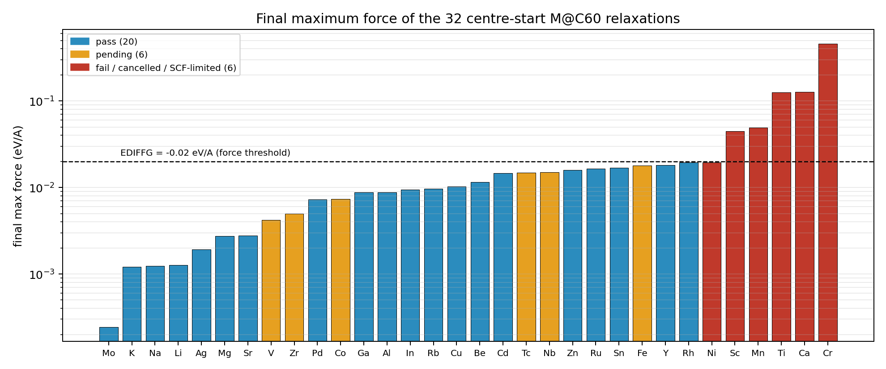
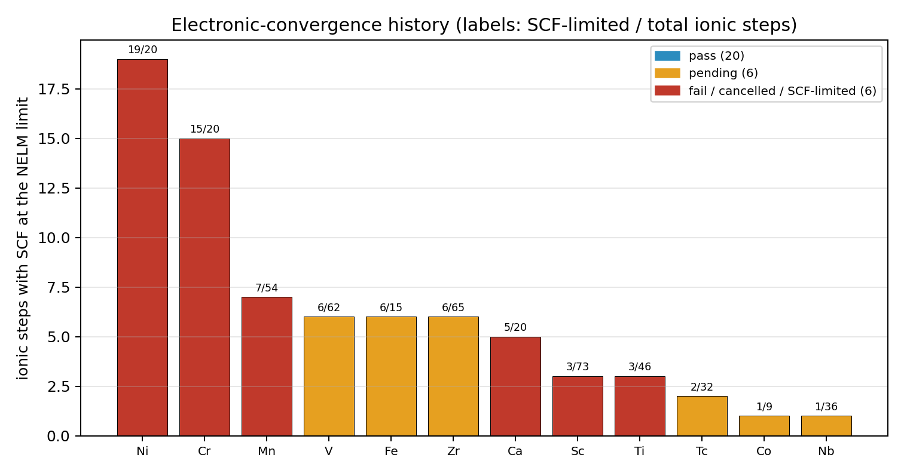
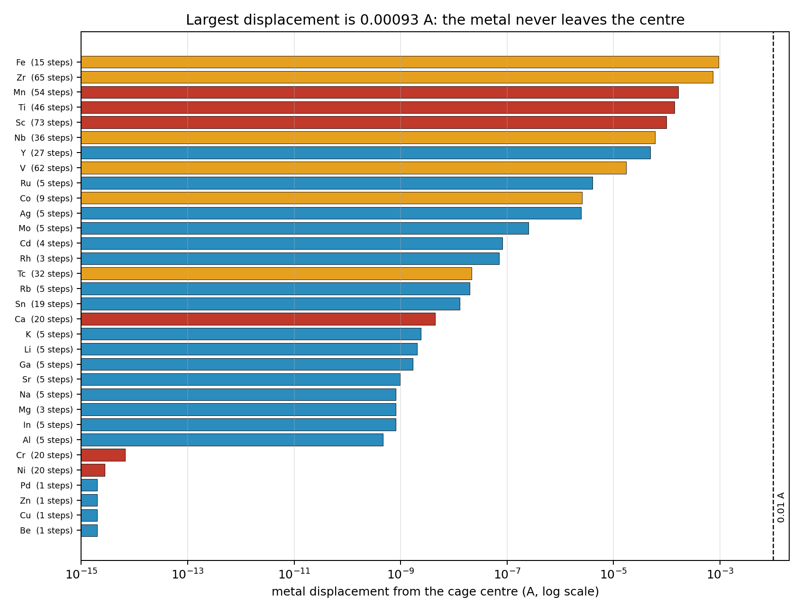
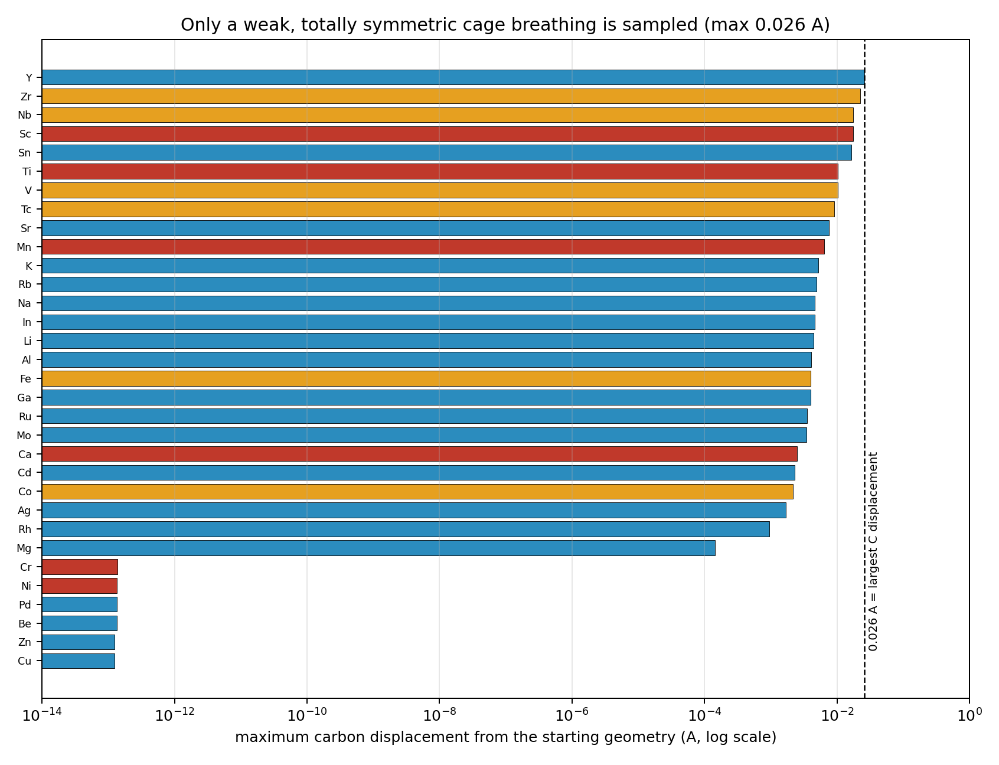

# Endohedral metals in C60 and the route to qHP/qTP fullerene networks

**An independent audit of the 32-metal centre-start screen and a feasibility assessment for endohedral network doping**

Version 1.0 — 16 November 2026

Companion data and code: this repository (see Section 9).

---

## 0. Executive summary

The question behind this report is strategic rather than computational: *can we identify metal atoms that can exist stably inside carbon cages, and then use those endohedral units as building blocks for qHP/qTP fullerene networks?*

The short answer is:

1. **The 20 / 6 / 6 classification is numerically correct.** Every number in the source report (final maximum force, number of ionic steps with the SCF at the NELM limit, normal versus abnormal termination, 90 C-C bonds and three-fold carbon coordination) is reproduced exactly by an independent audit of the delivered VASP files: 20 systems pass the stated numerical filter, 6 carry an electronic-convergence or provenance caveat, and 6 have no acceptable final state.
2. **The classification is nevertheless not evidence that these metals are stable inside C60.** The audit shows that in all 32 calculations the metal remained within 0.001 Angstrom of the exact cage centre (largest value 0.00095 Angstrom), and 18 of the 20 "passing" systems stopped after five or fewer ionic steps (four stopped after a single step). An atom placed exactly at the inversion centre of an Ih-symmetric C60 experiences a force that vanishes by symmetry, so a force-based relaxator *cannot* move it and will "converge" regardless of whether the centre is a minimum, a saddle, or a maximum. The screen therefore tested numerical noise, not endohedral stability.
3. **What the screen does establish** is that the C60 cage survives all 32 attempts (90 C-C bonds, all carbons three-coordinated, no C-C bond breaking in the analysed geometry), that the calculations are technically consistent with each other, and that the 20 systems form a reasonable *candidate shortlist* for a rigorous stability study. It also produces physically interesting magnetic moments: several open-shell metals retain atomic-like moments (Cr 5.9, Mn 6.3, Mo 6.0, Tc 5.9, V 5.0, Nb 5.0, Ru 4.0 Bohr magnetons), which suggests weak metal-cage hybridisation at the centre.
4. **The qHP/qTP network route is scientifically plausible and worth pursuing, but it must be re-sequenced.** The correct order is: (i) prove a true endohedral minimum and a site preference over exohedral binding for isolated M@C60; (ii) prove that the metal survives the polymerisation conditions (escape barrier); (iii) only then build the network. Starting from the current "20" directly would risk a large campaign built on a filter that does not discriminate.
5. **A two-track strategy is recommended.** Run the rigorous Stage-1 tests on a small set of closed-shell s-block metals (Li, Na, Be, Mg, Ca) while, in parallel, mining the existing 40-metal *exohedral* intercalation screen as the low-risk control. The decisive calculation is the site-competition energy between endohedral M@C60 and exohedral M-intercalated networks at the same composition.

The rest of this report substantiates these five points, gives the audit in full, and proposes a concrete staged computational protocol with explicit go/no-go criteria.

---

## 1. Question and scope

### 1.1 What was asked

The project has two linked objectives:

- **Objective A (this screen):** determine which metal atoms can be placed inside a C60 cage and remain there in a stable configuration.
- **Objective B (this proposal):** use the resulting endohedral units, M@C60, as building blocks for the quasi-hexagonal (qHP) and quasi-tetragonal (qTP) covalently linked C60 networks already studied in this project, with the long-term goal of thermoelectric and transport applications.

The delivered material is a 32-metal screening campaign in which each metal was placed at the exact centre of an isolated C60 in a 22 Angstrom cubic cell and relaxed with VASP. The source report classifies the outcome as 20 pass, 6 pending, and 6 fail.

### 1.2 What this report covers

This report does three things:

1. It **audits** the 20/6/6 classification against the raw OUTCAR, OSZICAR and CONTCAR files, independently of the source report.
2. It explains **why the audit changes the interpretation** of the result even though it confirms all of its numbers.
3. It assesses the **feasibility of the qHP/qTP network route** and proposes a staged computational plan.

### 1.3 What this report does not cover

- No new density-functional calculations were run for this report. All numbers come either from the delivered screening bundle or from the existing qHP/qTP reference structures and band summaries already present in this project.
- Experimental synthesis is discussed only at the level needed to judge feasibility.
- The report does not rank the metals by expected thermoelectric performance; that requires the network-level calculations described in Section 7.

---

## 2. The source screen as delivered

### 2.1 Systems and settings

Thirty-two metals were considered: Li, Be, Na, Mg, Al, K, Ca, Sc, Ti, V, Cr, Mn, Fe, Co, Ni, Cu, Zn, Ga, Rb, Sr, Y, Zr, Nb, Mo, Tc, Ru, Rh, Pd, Ag, Cd, In, Sn. Nineteen were calculated as new centre-start relaxations in this campaign; thirteen were reused from earlier campaigns and are described in the source report as meeting the same or a stricter convergence threshold.

The settings are summarised below (values taken from the INCAR files in the bundle):

| Setting | New runs (19) | Reused runs (13) |
|---|---|---|
| Functional / potential | PBE / PAW | PBE / PAW |
| Cell | 22 Angstrom cube, fixed | 22 Angstrom cube, fixed |
| k-points | Gamma only | Gamma only |
| ENCUT | 520 eV | 520 eV |
| EDIFF | 1e-5 | 1e-6 or 1e-7 |
| EDIFFG | -0.02 eV/A | -0.02 or -0.005 eV/A |
| NELM | 200 | 200 or 300 |
| POTIM | 0.2 | 0.2 or 0.3 |
| SIGMA | 0.02 eV | 0.02 or 0.05 eV |
| ISPIN | 2 | 2 |
| Initial magnetic moment | one chemically motivated guess per metal | one guess per metal (often different) |
| ADDGRID | not used | used in most reused runs |

Two consequences of this table matter for the interpretation. First, the dataset is **heterogeneous**: the reused runs are stricter in EDIFF and sometimes in EDIFFG, but looser or different in smearing and ionic step size. Second, the number of valence electrons differs between elements not only because of the element but because different PAW datasets were used (standard versus _pv/_sv variants, for example Sc_sv, Ti_sv, Y_sv, Nb_pv, Ru_pv, Rh_pv, Tc_pv). The neutral valence electron counts range from 241 to 255. Absolute total energies are therefore not comparable across elements, as the source report correctly states.

### 2.2 Stated result and acceptance criteria

The source report states that a system passes if it satisfies all of the following:

1. the job terminated normally;
2. the ionic relaxation converged;
3. the electronic iteration did not reach its upper limit;
4. the final maximum force does not exceed 0.02 eV/A;
5. the carbon cage retains its 90 bonds (1.8 Angstrom distance criterion) and every carbon remains three-coordinated.

On this basis the report gives:

- **20 pass:** Li, Be, Na, Mg, Al, K, Cu, Zn, Ga, Rb, Sr, Y, Mo, Ru, Rh, Pd, Ag, Cd, In, Sn.
- **6 pending:** V, Fe, Co, Zr, Nb, Tc (electronic-convergence history or provenance issue).
- **6 fail:** Ca, Sc, Ti, Cr, Mn, Ni (failed, cancelled, or final electronic step not converged).

### 2.3 Data bundle

The delivered bundle contains, for each system: INCAR, KPOINTS, POSCAR, CONTCAR, OSZICAR, a compressed OUTCAR, a compressed vasprun.xml, a compressed VASP log, a POTCAR audit file where available, and the Slurm stdout/stderr tails. It also contains the job accounting table, the collection manifest, the existing inventory, and the queue snapshot. The audit below uses the original bundle, copied unchanged into the calculations directory of this repository.

---

## 3. Independent audit of the 20 / 6 / 6 claim

### 3.1 Method

The script scripts/audit_screening.py re-parses the raw files and extracts:

- the final maximum force from the last TOTAL-FORCE block of OUTCAR;
- the number of ionic steps and the number of electronic steps per ionic step from OSZICAR;
- the number of ionic steps at which the electronic step count equals NELM (taken from each INCAR, not assumed);
- the terminal state: presence of the "reached required accuracy" message, presence of a ZBRENT fatal error, or a Slurm cancellation;
- the final geometry from CONTCAR: metal displacement from the cage centre and from its starting position, metal-carbon distances, cage radius, C-C bond count at 1.8 Angstrom, carbon coordination, and a point-in-cage test;
- the key INCAR settings and the initial magnetic moment assigned to the metal.

All definitions and thresholds are reproduced in Appendix B. The script writes data/screening_summary.csv and data/screening_summary.json, and the Markdown table in Appendix A is generated automatically from those files, so no number in this report is hand-transcribed.

### 3.2 Bookkeeping: all numbers reproduce

**Final maximum force.** The audit reproduces every force value quoted in the source report to four decimal places. For example: Li 0.0013, Be 0.0115, Na 0.0012, Mg 0.0028, Al 0.0088, K 0.0012, Cu 0.0102, Zn 0.0160, Ga 0.0088, Rb 0.0097, Sr 0.0028, Y 0.0182, Mo 0.0002, Ru 0.0164, Rh 0.0195, Pd 0.0072, Ag 0.0019, Cd 0.0146, In 0.0094, Sn 0.0168 eV/A. The failing systems have larger forces: Ni 0.0195 (just below the threshold but SCF-limited), Fe 0.0178, Co 0.0074, V 0.0042, Zr 0.0050, Nb 0.0150, Tc 0.0148, Sc 0.0447, Mn 0.0493, Ca 0.1277, Ti 0.1249, Cr 0.4585 eV/A.

*Figure 1. Final maximum force for the 32 centre-start relaxations, sorted and coloured by the source classification. The dashed line is the 0.02 eV/A threshold. This is the quantity that the source report used to define a pass.*

**Electronic-convergence history.** The audit reproduces the source counts exactly, including the fact that NELM is 300 for V, Co, Zr, Mo and Ag but 200 for most other systems:

- V: 6 SCF-limited ionic steps (steps 1-6), NELM = 300;
- Fe: 6 (steps 1, 2, 3, 4, 6, 14), NELM = 200;
- Co: 1 (step 1), NELM = 300;
- Zr: 6 (steps 1, 2, 3, 4, 19, 29), NELM = 300;
- Nb: 1 (step 1), NELM = 200;
- Tc: 2 (steps 5, 6), NELM = 200;
- Ni: 19 of 20 ionic steps, including the final step 20, NELM = 200;
- Ca: 5 (including the last recorded step), Sc: 3, Ti: 3, Cr: 15, Mn: 7.

*Figure 3. Number of ionic steps whose electronic loop reached NELM, for the 12 systems with at least one such step. The label gives SCF-limited steps divided by total ionic steps. The colours follow the source classification.*

**Termination.** The audit confirms:

- the 20 passing systems all contain the "reached required accuracy" message and have zero SCF-limited steps;
- Ca, Sc, Ti and Cr all died with the VASP ZBRENT fatal error ("ZBRENT: fatal error in bracketing ... I REFUSE TO CONTINUE WITH THIS SICK JOB"), i.e. the ionic line search could not bracket a minimum. This is a technical failure mode, not a physical result;
- Mn was cancelled by Slurm mid-SCF (the stderr tail contains the explicit cancellation record);
- Ni terminated normally, but its final electronic step had reached NELM = 200, so the forces that triggered the stopping criterion were computed from a non-converged charge density;
- Co has a normal OUTCAR ending but a Slurm state of CANCELLED. This provenance conflict is real and is correctly flagged by the source report.

**Geometry.** All 32 final geometries contain exactly 90 C-C bonds below 1.8 Angstrom and all 60 carbons are three-coordinated; the cage radius is 3.55 Angstrom in every case; the metal is inside the cage convex hull in every case. These are genuine results: the cage did not break in any of the 32 calculations.

### 3.3 Verdict on the 20 / 6 / 6 statement

**As a statement about calculation status, the classification is correct and reproducible.** There is no arithmetic error, no mislabelled system, and no hidden inconsistency in the delivered tables. If the sentence is read as "20 systems passed the normal-termination + force + cage-integrity filter, 6 need a provenance or SCF check, and 6 have no usable final state", it is accurate.

Five wording or framing points should nevertheless be corrected before the result is carried forward.

1. **"Pass" must not be read as "stable".** The audit shows that the filter was applied to a geometry in which the metal had no symmetry-allowed route away from the centre. The 20 are *candidates*, not stable endohedral systems. The source report already says it does not claim dynamical stability, but the headline "20 pass" is easily over-read.
2. **The pending bucket is not the only bucket with an SCF history.** Ca (5), Sc (3), Ti (3), Mn (7), Cr (15) and Ni (19) also have SCF-limited ionic steps. The first five are in the fail bucket because they have no normal endpoint; Ni has a normal endpoint but is rejected because its *final* step is SCF-limited. The classification is coherent, but the report should state that the "no SCF at the limit" criterion is applied to *all* systems, not only to the pending six.
3. **The fail bucket mixes three different failure modes.** Ca/Sc/Ti/Cr are line-search deaths (ZBRENT); Mn is a Slurm cancellation; Ni is a completed run rejected because its final SCF did not converge. These have different remedies and should be reported separately.
4. **The "same or stricter criterion" claim for the reused data is only partly true.** The reused runs are stricter in EDIFF and sometimes EDIFFG, but they differ in smearing (SIGMA 0.05 versus 0.02 eV), ionic step size (0.3 versus 0.2), ADDGRID, NELM (300 versus 200) and initial magnetic moments. They should be described as "compatible but not identical", and the 20 should not be presented as a homogeneous dataset.
5. **The NELM value differs between systems.** Five reused systems used NELM = 300 while the new screen used 200. This is worth stating explicitly, because a system that converges at step 210 would be classified differently under the two settings.

### 3.4 Per-system status

Appendix A gives the full audit table for all 32 systems: classification, provenance, final force, number of ionic steps, SCF-limited steps, final SCF count and NELM, termination mode, metal displacement, metal-carbon minimum distance, bond count and final magnetic moment.

---

## 4. Why the screen cannot answer "which metals are stable inside C60"

This is the central scientific point of the report. The screen tests five things (termination, force convergence, SCF convergence, cage integrity, carbon coordination). None of them is a stability criterion for an endohedral atom. The reasons are independent and additive.

### 4.1 The symmetry trap

The C60 molecule has Ih symmetry. Its geometric centre is an inversion centre. If a single atom sits exactly at that centre, the total energy is invariant under the full Ih point group, so the gradient of the energy with respect to a displacement of that atom vanishes **exactly** by symmetry, for any cage geometry that preserves the inversion symmetry. In exact arithmetic the force on the metal is zero; in a plane-wave calculation it is zero up to numerical noise.

Every one of the 32 calculations started with the metal at the exact centre. The POSCAR of the new runs places the metal at (11.000, 11.000, 11.000) in a 22 Angstrom cube, i.e. the exact cell centre, and the reused runs are documented as centre-origin candidates. The audit result is therefore not surprising:

- the metal displacement from the centre is below 0.001 Angstrom in **all 32** systems; the largest value is 0.00095 Angstrom (Fe);
- 18 of the 20 passing systems stopped after five or fewer ionic steps;
- Be, Cu, Zn and Pd stopped after a **single** ionic step;
- the maximum carbon displacement from the starting geometry is at most 0.026 Angstrom (Y); most systems move their carbons by less than 0.01 Angstrom.

Figures 2 and 4 show these two facts directly.

*Figure 2. Metal displacement from its starting position for all 32 systems, on a logarithmic scale. The largest value is 0.00093 Angstrom (Fe); the dashed line marks 0.01 Angstrom. The metal never leaves the centre, independently of how many ionic steps the run took.*

*Figure 4. Maximum carbon displacement from the starting geometry. The largest value is 0.026 Angstrom (Y). The relaxator only samples the totally symmetric breathing of the cage, not a symmetry-breaking distortion.*

The only structural mode that the relaxator can sample from this starting point is the totally symmetric breathing of the cage. With a numerical noise floor of order 1e-9 Angstrom and a force threshold of 0.02 eV/A, any symmetry-breaking distortion that develops from noise during the run is far too small to be detected, let alone to move the metal off the centre.

What follows is important: **a negative curvature of the centre is invisible to this test.** If the centre is a saddle point, the force at the exact centre is still zero, and the numerical noise (typically 1e-9 to 1e-7 Angstrom) generates forces far below the 0.02 eV/A threshold. A force-based relaxator stops immediately. The screen therefore cannot distinguish:

- a genuine minimum (what the project wants to identify),
- a saddle point along an off-centre displacement,
- a maximum (what a large ion in a too-small cavity would give).

This is not a criticism of the calculations; it is a property of the test design. The source report itself notes that "the exact centre start may remain at a symmetric stationary point" and that "small forces and cage retention do not prove that the centre configuration is the lowest-energy state". The audit simply quantifies how universal this caveat is: it applies to *every one of the 32* systems, including all 20 "passes".

**The fix is cheap and decisive.** Displace the metal by 0.1-0.3 Angstrom along a symmetry-breaking direction (x, y, z, towards the centre of a hexagon, towards the centre of a pentagon) and relax again. If the metal returns to the centre from every displaced start, the centre is a local minimum along those directions. If it drifts off-centre and stays there, the centre is not the minimum and the true endohedral geometry is off-centre. Seven starts per metal are enough for a first pass. A partial Hessian of the metal (six single-point displacements) gives the same information more directly.

### 4.2 No formation energy and no site competition

Even a true endohedral minimum is not the same thing as a stable endohedral system. Two energies are needed:

- **Encapsulation energy:** dE_endo = E(M@C60) - E(C60) - E(M). This must be negative for the endohedral form to be thermodynamically favourable relative to the separated constituents, and it must be more negative than the energy of competing phases.
- **Site-competition energy:** dE_endo - dE_exo, where dE_exo is the energy of the metal bound to the outside of the cage. For most metals the exohedral isomer is a genuine local minimum and is often the global minimum; endohedral fullerenes are frequently metastable with respect to exohedral binding.

Neither quantity is in the delivered bundle: the bundle contains only M@C60 runs, no isolated C60, no isolated metal atom, and no exohedral isomer, and the total energies cannot be combined across elements because the PAW datasets differ. The screen therefore cannot answer the question "is the metal stably inside the cage?", only "does the centred geometry have small forces?".

A third energy is equally important for a synthesis-oriented project: the energy of the metal *outside* the cage, in an interstitial site of the network. For electropositive metals in a close-packed C60 solid, interstitial sites are often the ground state. The existing exohedral intercalation screen in this project (40 metals, 8 networks, one to four dopants per cell) is exactly the dataset needed for this comparison and should be treated as the control arm of the endohedral study.

### 4.3 Spin states were not ranked

Each metal was started from a single, chemically motivated initial moment. For the new runs the metal moment was set to a Hund-rule-like value (for example Cr 6, Mn 5, Nb 5, Ru 4, Rh 3 Bohr magnetons) or to zero for closed-shell cases; the reused runs used different guesses (for example Li 3). One initial guess is not a spin-state search. Several final states are atomic-like:

| System | Final moment (Bohr magnetons) |
|---|---|
| Cr | -5.91 |
| Mn | +6.27 |
| Mo | +5.99 |
| Tc | -5.91 |
| V | +5.00 |
| Nb | +5.00 |
| Fe | +4.41 |
| Ru | +4.00 |

These large moments indicate weak metal-cage hybridisation at the centre, which is qualitatively consistent with an ionic endohedral picture for the electropositive metals. But they are also exactly what a metastable, atomic-like SCF solution would give. For 3d metals in particular, the energy differences between spin states can be tens of meV, and a single initial guess can converge to the wrong one. A proper treatment requires several spin states per metal, broken-symmetry starts, and possibly DFT+U or a hybrid functional for the exchange splitting. This is a substantial additional calculation but it is unavoidable if the transition metals are to be included in the network study.

### 4.4 No vibrational analysis

Force convergence does not imply that the geometry is a minimum. The definitive test is the Hessian: if one or more normal modes have imaginary frequencies, the geometry is a saddle. For an endohedral atom the most important mode is the metal-cage displacement mode (the metal rattling against the cage), because its curvature decides whether the centre is a minimum or a saddle. This mode is precisely the one that the centre-start relaxation cannot probe (Section 4.1). A partial Hessian (six displacements of the metal only) is cheap and sufficient for a first pass; full phonons are needed only for the finalists.

### 4.5 Reused-data heterogeneity and provenance

The 20 passes are nine reused results and eleven new ones. The reused results come from at least five earlier campaigns with different INCAR settings, different initial moments and, in one case (Co), a Slurm record that conflicts with the OUTCAR ending. The specific provenance issues are:

- **V:** six SCF-limited steps plus, according to the source report, an independent earlier centre static recheck that did not pass. This should either be re-run or excluded from the candidate list.
- **Zr:** six SCF-limited steps plus a similar earlier negative recheck.
- **Co:** normal OUTCAR ending but Slurm CANCELLED. The calculation itself may be fine, but the record must be reconciled.
- **Fe:** six SCF-limited steps in a reused pilot calculation; the final geometry is acceptable but the electronic history is not clean.
- **Nb and Tc:** one and two SCF-limited steps respectively, early in the relaxation, with the final step converged. These are the least severe cases and can probably be fixed by a re-run with NELM = 300 and better mixing.

None of these issues invalidates the audit; they simply mean that the "20" is not a set of uniformly clean calculations.

### 4.6 What the cage-integrity check does and does not prove

The 90-bond and three-coordination test is a good and cheap safety check. It proves that no C-C bond was broken in the final geometry. It does not prove:

- that the cage did not undergo a Stone-Wales isomerisation or a bond rearrangement that preserves the count (a 1.8 Angstrom threshold would not detect a bond broken at 1.9 Angstrom and replaced elsewhere);
- that the metal is inside the cage (the audit adds a convex-hull test, which all 32 pass, but the source report's five criteria do not include it explicitly);
- that the cage geometry is the intended one, because the threshold is generous: a C-C contact of 1.79 Angstrom counts as a bond.

These are minor issues for the current screen but become important for the network stage, where the cage is deliberately distorted by polymerisation.

---

## 5. What the data do support

The audit is not purely negative. The following conclusions are supported by the data and are useful for the next stage.

1. **The C60 cage is robust against all 32 metal insertions.** In every calculation the cage retained 90 C-C bonds, all carbons remained three-coordinated, the cage radius stayed at 3.55 Angstrom, and the metal remained inside the cage hull. No cage opening, no carbon loss and no carbide formation was observed. This is a real and encouraging result for the endohedral route.
2. **The 20 passing systems are a defensible candidate shortlist.** They are the systems in which the numerical machinery (SCF, forces, geometry) behaved well. Starting a rigorous stability study from these 20, rather than from all 32, is sensible.
3. **The failures are technical, not physical.** ZBRENT line-search deaths (Ca, Sc, Ti, Cr) are a known VASP pathology on flat or stiff potential-energy surfaces and are usually fixed by switching to IBRION = 1, reducing POTIM, improving the mixing, or restarting from the last CONTCAR. They do not imply that the cage is unstable. The Slurm cancellation of Mn is not a scientific result at all.
4. **The SCF histories are fixable.** In V, Fe, Co, Zr, Nb and Tc the electronic non-convergence is concentrated in the early ionic steps (the first few steps of a fresh charge density, especially for open-shell metals with large moments) and is consistent with insufficient mixing rather than a fundamental problem; in Ni it persists through the whole run and into the final step, which points to the same mixing problem but is more severe. NELM = 300, a larger mixing parameter, a better initial guess (from the converged density) and a more conservative POTIM should resolve it.
5. **The magnetic moments are physically informative.** The atomic-like moments of the open-shell metals suggest that, at the centre, the metal-cage interaction is weak. If that survives a proper spin-state search, it supports the ionic endohedral picture (metal cation plus charged cage) that the network route needs. If it does not survive, it is a warning that the centre is not the true minimum.

---

## 6. From M@C60 to qHP/qTP networks: feasibility

### 6.1 The host networks

The qHP and qTP phases are two-dimensional, covalently linked C60 monolayers. In the terminology of the recent literature on monolayer fullerene networks, qHP is the quasi-hexagonal phase and qTP is the quasi-tetragonal phase; they differ in the number and orientation of the inter-cage C-C bonds (see Peng and Pizzochero, Chem. Commun. 61, 10287 (2025), and the references therein). The project already has reference cells, band structures and transport workflows for these phases.

The reference structures used here give the following picture (full table in Appendix D):

| Network | Dim | Cages/cell | n_C | C(4-fold) | inter-cage C-C bonds/cage | inter bond (A) | V/cage (A^3) | gap PBEsol (eV) | gap HSE (eV) |
|---|---|---|---|---|---|---|---|---|---|
| C20_qHPC20 | 2D | 1 | 20 | 8 | 10.0 | 1.597 | 749.3 | - | - |
| C20_qTPC20-b | 2D | 1 | 20 | 6 | 3.0 | 1.596 | 803.6 | - | - |
| C20_qTPC20-r | 2D | 1 | 20 | 8 | 8.0 | 1.582 | 665.3 | - | - |
| C24_qHPC24 | 2D | 1 | 24 | 10 | 13.0 | 1.573 | 910.3 | - | - |
| C24_qTPC24 | 2D | 1 | 24 | 12 | 18.0 | 1.572 | 930.8 | - | - |
| C36_qHPC36-D6h | 2D | 1 | 36 | 12 | 6.0 | 1.665 | 977.6 | - | - |
| C36_qTP2C36-D2d | 2D | 1 | 36 | 8 | 8.0 | 1.584 | 1424.5 | - | - |
| C60_qHPC60 | 2D | 2 | 120 | 16 | 6.0 | 1.595 | 2064.9 | 0.875 (direct) | - |
| C60_qTP1C60 | 2D | 1 | 60 | 4 | 4.0 | 1.581 | 2233.8 | 0.855 (indirect) | 1.368 (indirect) |
| C60_qTP2C60 | 2D | 1 | 60 | 8 | 8.0 | 1.588 | 1634.2 | 0.929 (indirect) | 1.510 (indirect) |
| Mg2C60_bulk | 3D | 1 | 60 | 6 | 5.0 | 1.591 | 620.5 | 0.055 (indirect) | 0.325 (indirect) |

The key points for the endohedral route are:

- **The C60 networks are wide-gap semiconductors in the pristine form:** 0.875 eV (direct) for qHPC60, 0.855 eV (indirect) for qTP1C60 and 0.929 eV (indirect) for qTP2C60 at the PBEsol level; HSE widens qTP1 and qTP2 to 1.37 and 1.51 eV. There is plenty of room to tune the gap by doping.
- **Electron doping closes the gap dramatically.** The related three-dimensional compound Mg2C60, in which Mg is intercalated between C60 cages, has a PBEsol gap of only 0.055 eV (0.325 eV at HSE). This shows that filling the C60-derived bands with two electrons per cage can produce a small-gap material, and it is the main existing precedent for the endohedral idea; the quantitative effect in the qHP/qTP monolayers still has to be computed.
- **The networks are strongly bonded but not rigidly so.** The inter-cage C-C bonds are 1.57-1.60 Angstrom; the in-plane lattice constants are 9.0-9.9 Angstrom (the hexagonal qHP cell uses a 9.12 Angstrom a repeat and a 15.75 Angstrom b axis containing two rows of cages), and the vacuum between layers is 13-22 Angstrom, so these are genuine monolayers.
- **A structural caveat.** In the qHPC60 reference cell used here, 8 of the 120 carbon atoms are only two-coordinated within their own cage (the third intra-cage contact is 2.26 Angstrom) and each of them forms two inter-cage bonds. Whether this is the intended ring-opened qHP linkage or a junction defect in the reference model should be settled before production network calculations, because it affects both the electronic structure and the escape path of an endohedral metal.
- **Mg2C60 is a three-dimensional network**, not a monolayer: it is included here because it is the closest existing example of an electron-doped C60 network and provides the experimental/theoretical precedent for gap closing.

### 6.2 Why endohedral doping is attractive

Putting the metal inside the cage, rather than between the cages, has five potential advantages for a thermoelectric network:

1. **Site order without disorder.** Every cage carries exactly one metal atom (two for M2@C60). There is no partial occupancy, no interstitial disorder and no phase separation into doped and undoped regions, which is a persistent problem in intercalated C60 compounds.
2. **Protection of the dopant.** The metal is encapsulated and cannot be oxidised, solvated or volatilised during processing, as long as it stays inside and the cage stays closed.
3. **Local phonon scattering.** A heavy atom rattling inside each cage is a localised low-frequency oscillator. This is the same physics that suppresses the lattice thermal conductivity in skutterudites and clathrates, and it is attractive for thermoelectrics, provided the rattling does not scatter the charge carriers too strongly.
4. **Clean charge transfer.** For electropositive metals the metal donates one or two electrons to the cage and remains a closed-shell cation. The C60 t1u-derived band is filled in a controlled way. This is the same mechanism that stabilises the 1D polymer phases of KC60 and RbC60, where electron doping drives the [2+2] polymerisation (Stephens et al., Nature 370, 636 (1994)). There is therefore a real precedent for the idea that an endohedral alkali metal could stabilise, rather than disrupt, a qTP-type chain or a qHP sheet.
5. **Compatibility with the existing workflow.** The network models, band workflows and transport pipelines already exist. Only the building block changes (C60 becomes M@C60).

### 6.3 The three couplings that decide feasibility

**(a) Charge transfer and band filling.** A single alkali atom adds one electron; an alkaline earth adds two. The C60 LUMO-derived band can hold up to six electrons, so both are accessible. The Mg2C60 precedent shows that two electrons per cage can close the gap to ~0.05 eV in a C60 network. A qHP/qTP network with one metal per cage is therefore likely to be metallic or near-metallic, which is good for electrical conductivity but not necessarily optimal for the Seebeck coefficient. Two knobs are available: the valence of the metal (one versus two electrons) and the loading (co-polymerisation of M@C60 with empty C60, which introduces some disorder). The network calculations must map the gap and the Fermi level as a function of these two knobs.

**(b) Steric fit and cage distortion.** The C60 cage has a carbon-nucleus radius of 3.552 Angstrom. Taking a carbon van der Waals radius of 1.70 Angstrom (Bondi), the free cavity radius is about 1.85 Angstrom, or a free diameter of about 3.7 Angstrom. This is a heuristic, not a thermodynamic criterion, but it is a useful filter:

| Ion | Shannon radius (Angstrom, CN 6) | Clearance to the free cavity (Angstrom) |
|---|---|---|
| Be2+ | 0.45 | +1.40 |
| Mg2+ | 0.72 | +1.13 |
| Li+ | 0.76 | +1.09 |
| Ca2+ | 1.00 | +0.85 |
| Na+ | 1.02 | +0.83 |
| Sr2+ | 1.18 | +0.67 |
| K+ | 1.38 | +0.47 |
| Rb+ | 1.52 | +0.33 |
| Cs+ | 1.67 | +0.18 |

All the s-block cations have positive clearance, so **steric fit alone does not discriminate among them**. This is important: the common intuition that "K and Rb are too big for C60" is not supported by a simple hard-sphere estimate. The real discriminators are electronic (charge transfer, hybridisation) and kinetic (escape barrier, synthesis), not size. For transition metals the ionic-radius picture is not reliable at all, because they form directional metal-carbon bonds and the relevant quantity is the metal-cage bonding energy, not a radius.

Cage distortion by polymerisation matters here. In the qHP/qTP networks the carbon cage is already strained by the inter-cage bonds. An endohedral metal that expands the cage (or that binds to one side) will compete with that strain. This is why the network-level calculations must be done with the distorted cage, not with the isolated C60.

**(c) Metal-cage bonding.** For d-block metals the metal-cage interaction is not a simple ionic attraction. The metal can bind to a ring on the inner surface, break the inversion symmetry, distort the cage, and in the worst case open a C-C bond. This is likely to be the dominant effect for Sc, Ti, V, Cr, Mn, Fe, Co, Ni, Y, Zr, Nb, Mo, Tc, Ru, Rh, Pd and Ag, and it is why those metals should be treated as a separate, higher-risk tier. The large atomic-like moments found in the screen are a hint that, at the centre, the hybridisation is weak, but they do not prove that the true minimum is at the centre.

### 6.4 Competing states and the decisive comparison

An endohedral M@C60 network is only one of several possible states of the same composition. The relevant competing states are:

1. **Endohedral metal in the qHP/qTP network** (the target);
2. **Exohedral metal intercalated between the cages** (the existing screen);
3. **M@C60 molecular solid**, with no polymerisation;
4. **Phase separation** into a metal-doped C60 phase plus an undoped network;
5. **Metal carbide or metal cluster plus a defected carbon network** (the thermodynamic sink if the metal-cage interaction is strong).

The decisive calculation is the total-energy comparison between states 1 and 2 at the same composition, with the same PAW datasets and the same cell. If state 2 is lower by more than about 0.2 eV per metal, the endohedral route is metastable and requires kinetic trapping; if state 1 is lower or comparable, the endohedral route is thermodynamically viable. This comparison has not been made yet, and it is the single most valuable calculation that can be done with the existing data and infrastructure.

Note that the existing exohedral intercalation screen (40 metals, eight networks, one to four dopants per cell) already provides the structures for state 2. It is therefore possible to run the comparison without building new structures from scratch.

### 6.5 Synthesis reality check

This is the weakest link in the endohedral route, and it should not be underestimated.

- **Production of bulk M@C60 is hard.** To our knowledge, only Li@C60 and Na@C60 have been produced and characterised at the level needed for materials work (Tellgmann et al., Nature 382, 407 (1996); and the Chalmers work on alkali endohedral fullerenes). Heavier M@C60, including K@C60, are computational proposals: DFT studies find them stable inside the cage (de Oliveira and Goncalves, Comput. Chem. 2, 51 (2014); Malani et al., J. Phys. Chem. A 117, 3521 (2013)), but they have not been isolated in macroscopic quantities. If the network route requires, say, 100 mg of M@C60, the synthesis is the bottleneck, not the DFT.
- **The polymerisation conditions are aggressive.** qHP/qTP networks are made by high-pressure/high-temperature treatment, photo-irradiation or electron irradiation. The metal must survive these conditions without escaping, aggregating or forming a carbide. The escape barrier through a six-membered ring is the key quantity, and it is computable with NEB.
- **A possible mitigation** is to start from a co-polymer of M@C60 and C60, which lowers the required endohedral fraction and allows the doping level to be tuned. The price is site disorder, which the endohedral route was supposed to avoid.

### 6.6 Family-by-family assessment

The following tiering is a hypothesis for testing, not a conclusion of the current data. It is based on the chemistry of the elements, the audit, and the known endohedral fullerene literature.

**Tier 1 — start now.** Li, Na. To our knowledge, these are the only metals for which macroscopic endohedral C60 chemistry is demonstrated. They are closed-shell cations, they donate one electron per cage, and they are small enough that the cage strain is modest. Be and Mg are Tier 1b: closed-shell, two electrons per cage; DFT studies of Be2+@C60, Mg2+@C60 and Ca2+@C60 are available (de Oliveira and Goncalves, 2014). Mg is particularly interesting because Mg2C60 already gives the small-gap precedent, and because the endohedral Mg2 electride chemistry (Das, Saha and Chattaraj, J. Comput. Chem. 41, 1645 (2020)) shows that magnesium inside C60 has rich and non-trivial behaviour that must be checked.

**Tier 2 — conditional.** K, Rb, Sr, Ca. These are closed-shell cations with positive but smaller steric clearance. DFT says K+@C60 is a stable endohedral species, but it has not been isolated, and the larger ions have a higher chance of an off-centre minimum. They should be tested with the displaced-start and Hessian protocol before any network work.

**Tier 3 — high risk.** Al, Ga, In, Sn, Cd. These are p-block or d10s2 metals with directional bonding. The centre may be a saddle and the true minimum off-centre. Only proceed if Stage 1 passes.

**Tier 4 — not recommended without a dedicated study.** Sc, Ti, V, Cr, Mn, Fe, Co, Ni, Y, Zr, Nb, Mo, Tc, Ru, Rh, Pd, Ag. These are open-shell transition metals with strong metal-carbon bonding and large magnetic moments. They are much more likely to bind off-centre, distort the cage, and be sensitive to spin state. They are also the metals with the worst SCF histories in the screen. If the project wants transition-metal functionality, the exohedral intercalation route is a much lower-risk first target.

### 6.7 Verdict on feasibility

**The route is feasible in principle and worth a focused, staged effort, but the current 32-metal screen is not the right foundation for a large network campaign.** The logic "find a metal that is stable in a cage, then polymerise the cage" is sound, but the first step has not yet been demonstrated: the screen only shows that a centred atom has small residual forces. Three calculations are missing and they are all doable with the existing infrastructure: a displaced-start/Hessian test for a true minimum, a formation-energy comparison against the exohedral isomer, and an escape barrier. If those three pass for a small set of metals, the network stage is well motivated; if they fail, the project should pivot to exohedral intercalation, for which the structures and part of the workflow already exist.

---

## 7. Proposed staged protocol

The protocol below is designed so that each stage has a clear go/no-go decision and a bounded cost. It uses the same VASP setup as the existing campaign (PBE/PAW, 520 eV, 22 Angstrom box for molecules, Gamma point) with dispersion correction (D3) added and tighter electronic settings.

### Stage 0 — data hygiene (days)

- Re-run V, Zr, Fe, Co, Nb and Tc with NELM = 300, EDIFF = 1e-6, improved mixing (AMIX/BMIX), and, where relevant, a starting charge density from the previous run. Resolve the Co Slurm/OUTCAR conflict.
- Re-run Ca, Sc, Ti and Cr with IBRION = 1 (or 2 with a smaller POTIM) and better mixing, to establish whether the ZBRENT failures were purely technical.
- Split the fail bucket into the three failure modes in the reporting.
- Store a machine-readable manifest with INCAR, POTCAR hashes, NELM, EDIFF, EDIFFG, initial moments and termination status for every run. The audit script in this repository already produces most of this table.

### Stage 1 — isolated M@C60: is the centre a true minimum? (1-2 weeks)

For each candidate metal (start with Li, Na, Be, Mg, Ca; add K, Rb, Sr if time permits):

- **1a. Displaced starts.** Eight geometries per metal: metal displaced by +/-0.15 and +/-0.30 Angstrom along x, y and z (six starts), plus one displacement towards a hexagon centre and one towards a pentagon centre. Relax with ISIF = 2, IBRION = 1 or 2, POTIM = 0.2, EDIFF = 1e-6, EDIFFG = -0.005, NELM = 300, spin-polarised with several initial moments. Pass if the metal returns to the centre from every start (centre is a local minimum along the tested directions).
- **1b. Partial Hessian of the metal.** Displace the metal by +/-0.01 Angstrom in x, y, z and compute the forces on the metal; from the six force evaluations build the 3x3 Hessian. Pass if all three eigenvalues are positive. Full phonons (IBRION = 5, NFREE = 2) only for the finalists.
- **1c. Formation energies.** E(M@C60), E(C60), E(M) and E(M outside C60, relaxed over a hexagon and over a pentagon), all in the same 22 Angstrom box with the same PAW datasets and D3. Compute dE_endo and dE_exo. Pass if dE_endo < 0 and dE_endo - dE_exo < 0.
- **1d. Electronic structure.** Bader or DDEC charges, total magnetic moment, and the position of the Fermi level relative to the C60 t1u-derived states. Pass if the charge transfer is consistent with the nominal ionic picture (Li about +0.9, Mg about +1.8) and the moment is either quenched or understood.
- **1e. Escape barrier.** CI-NEB from the centre to the outside through a six-membered ring (five images, climbing image). Pass if the barrier is above about 2 eV, which is the scale needed to survive polymerisation at a few hundred degrees Celsius.

### Stage 2 — dimerisation and polymerisation (2-3 weeks)

- Compute the [2+2] dimerisation of two M@C60 units and compare with the pristine C60 dimer: binding energy, inter-cage bond length, metal displacement and cage distortion.
- Check whether the metal remains centred after dimerisation; if it drifts, the network will be composed of anisotropic cages.
- Compute the dimerisation barrier; it should not be dramatically higher than for pristine C60.
- Repeat for a co-dimer M@C60 + C60, which is the relevant unit for a mixed network.

### Stage 3 — qHP/qTP network calculations (1-2 months)

- Build the network cells by replacing each C60 in the reference cell with the relaxed M@C60 geometry (align by the cage atoms), for qTP1 (one cage per cell), qTP2 and qHP.
- Relax with ISIF = 2 first, then in-plane ISIF = 3 with the vacuum axis fixed; k-mesh 4x4x1 for qTP and 4x2x1 for qHP; ENCUT 520 eV; D3; spin-polarised.
- Compute the formation energy per formula unit relative to the relaxed M@C60 plus the pristine network.
- Compute phonons on a 2x1x1 supercell; check for imaginary modes.
- Compute the band structure and DOS; extract the gap and the Fermi level. Compare with the pristine network and with Mg2C60.
- Only if the gap is in the 0.05-0.5 eV range and the phonons are stable, run the existing transport workflow (AutoZT/AMSET) for the Seebeck coefficient, conductivity and lattice thermal conductivity.

### Stage 4 — site competition against exohedral intercalation (2-3 weeks)

- For the same metal and the same network, compute the endohedral and exohedral total energies with identical settings.
- The exohedral structures already exist in the intercalation screen; only the endohedral counterparts need to be built.
- Decide the project direction from the energy difference and the barriers, not from the current 20/6/6 classification.

### Go/no-go summary

| Test | Quantity | Pass criterion |
|---|---|---|
| True minimum | displacement returns to centre; Hessian eigenvalues | all positive |
| Encapsulation | dE_endo = E(M@C60) - E(C60) - E(M) | negative |
| Site preference | dE_endo - dE_exo | negative |
| Kinetics | escape barrier through a six-ring | > 2 eV |
| Cage integrity | C-C bonds, coordination, max distortion | 90 bonds, all C 3-fold, distortion < 5 percent |
| Network stability | formation energy, phonons | negative, no imaginary modes |
| Thermoelectric window | gap, Fermi level | 0.05-0.5 eV, tunable |

### Cost estimate

A single 61-atom M@C60 relaxation at 520 eV and Gamma point costs between about 20 minutes and a few hours on 64 cores for a well-behaved run; the delivered screen took 19 minutes to 2 days 7 hours, with most of the long runs spent on difficult SCF. A displaced-start campaign (7 starts per metal, 5 metals) is therefore a few days of cluster time. A partial Hessian is six single-point calculations per metal. A NEB is a few hundred core-hours. The network relaxation is the expensive step: 122 atoms (qHP with two cages) with a 4x2x1 mesh and 100-200 ionic steps is a few days per metal. This is why the go/no-go filters should be applied before the network stage.

---

## 8. Concrete recommendations

### 8.1 Immediate next round (two weeks)

1. **Do not use the 20 as a stability list.** Re-label them as "20 systems that passed the numerical filter" and add the symmetry-trap limitation to the report and to any presentation.
2. **Run the displaced-start and partial-Hessian tests (Stage 1a/1b) for Li, Na, Be, Mg and Ca.** This is the highest-information-per-core-hour calculation in the whole project.
3. **Fix the provenance issues** for V, Zr, Fe, Co, Nb and Tc, and re-run Ca, Sc, Ti and Cr with a more robust ionic optimiser. This costs little and removes six caveats from the dataset.
4. **Compute the formation energies (Stage 1c) for the same five metals**, including the exohedral isomer. This turns the project from a geometry screen into a thermodynamics study.

### 8.2 For the network campaign

5. **Build the endohedral network models only after Stage 1 passes.** If the centre is a saddle for a given metal, the network model built from the centred geometry is not physical.
6. **Treat the existing exohedral intercalation screen as the control arm.** The decisive number is the endohedral-versus-exohedral energy difference at the same composition, not the isolated-cage energy.
7. **Use the metallic valence as the primary doping knob.** One electron per cage (alkali) and two electrons per cage (alkaline earth) span the interesting range, and the Mg2C60 precedent shows that two electrons close the gap.
8. **Keep the transition metals out of the first network round.** They are high-risk, they have the worst SCF histories, and their exohedral chemistry is a more promising first target.

### 8.3 For reporting and publication

9. **Separate the three statements that are currently conflated:** (i) the calculations terminated and converged; (ii) the cage survived; (iii) the metal is stable inside the cage. Only (i) and (ii) are demonstrated.
10. **State the symmetry limitation explicitly** in the methods section: "centre-start relaxations of an Ih-symmetric C60 cannot break the inversion symmetry; the resulting geometries are stationary points whose stability was not tested."
11. **Report the failure modes separately** (line-search death, cancellation, SCF-limited final step) rather than as a single "fail" category.

---

## 9. Repository contents and reproducibility

The repository is organised as follows:

    README.md
    report/
        endohedral_c60_network_feasibility_report.md   (this document)
    data/
        screening_summary.csv / .json                   (per-system audit)
        screening_table.md                              (Appendix A, generated)
        network_geometry.csv / network_table.md          (Appendix D, generated)
        accounting.txt, collection_manifest.json, existing_inventory.json, queue.txt
    calculations/
        center32_screen/...                              (19 new centre-start runs)
        pilot_Li_Fe/..., batch_*/..., stage4_*/..., stage5_*/...
        Mg_center_m0_tight_s002/...
    network_reference/
        *.POSCAR                                         (qHP/qTP and Mg2C60 reference cells)
        band_gaps/*.json                                 (PBEsol and HSE band summaries)
    figures/
        fig1_force_convergence.png
        fig2_symmetry_trap.png
        fig3_scf_history.png
        fig4_cage_breathing.png
    scripts/
        audit_screening.py
        network_geometry.py
        make_figures.py
        make_tables.py
    docs/
        32种金属C60中心初筛汇报.docx                     (original Chinese source report)

Reproduction:

    python scripts/audit_screening.py
    python scripts/network_geometry.py
    python scripts/make_figures.py
    python scripts/make_tables.py

The audit script reads the original OUTCAR, OSZICAR and CONTCAR files and requires only numpy (scipy is used for the convex-hull test and is optional). The tables in the report are regenerated by make_tables.py, so the report and the CSV cannot drift apart.

**Limitations of this audit.** The audit re-parses the delivered files; it does not re-run VASP. The point-in-cage test uses the convex hull of the carbon positions, which is valid for a convex C60 cage but should be interpreted with care for strongly distorted cages. The symmetry argument in Section 4.1 assumes that the starting geometry is exactly inversion-symmetric, which is true for all runs in the bundle (metal at the cell centre) but has been checked from POSCAR, not from the VASP symmetry flags. The force values are those printed in the final TOTAL-FORCE block and are not recomputed from the wavefunction.

---

## 10. References

1. C. Peng, M. Pizzochero, "Monolayer C60 networks: a first-principles perspective", Chem. Commun. 61, 10287-10302 (2025). DOI: 10.1039/d5cc02473k. arXiv:2504.21485.
2. R. Tellgmann, N. Krawez, S.-K. Lin, I. V. Hertel, E. E. B. Campbell, "Endohedral fullerene production", Nature 382, 407-408 (1996). DOI: 10.1038/382407a0.
3. P. W. Stephens, G. Bortel, G. Faigel, M. Tegze, A. Janossy, S. Pekker, G. Oszlanyi, L. Forro, "Polymeric fullerene chains in RbC60 and KC60", Nature 370, 636-639 (1994). DOI: 10.1038/370636a0.
4. A. Malani, et al., "Theoretical insight for the metal insertion pathway of endohedral alkali metal fullerenes", J. Phys. Chem. A 117, 3521-3528 (2013). DOI: 10.1021/jp4007697.
5. O. V. de Oliveira, A. da S. Goncalves, "Quantum chemical studies of endofullerenes (M@C60) where M = H2O, Li+, Na+, K+, Be2+, Mg2+, and Ca2+", Comput. Chem. 2, 51-58 (2014). DOI: 10.4236/cc.2014.24007.
6. A. Krisilov, I. V. Nechaev, V. E. Chernov, G. E. Kallu, "DFT calculations of structure and IR spectra of M@C60 and M2@C60 endofullerenes (M = Sc and Y)", Molecules 30, 3421 (2025). DOI: 10.3390/molecules30163421.
7. S. Das, S. Saha, P. K. Chattaraj, "Encapsulation of Mg2 inside a C60 cage forms an electride", J. Comput. Chem. 41, 1645-1653 (2020). DOI: 10.1002/jcc.26207.
8. R. D. Shannon, "Revised effective ionic radii and systematic studies of interatomic distances in halides and chalcogenides", Acta Crystallogr. A 32, 751-767 (1976). DOI: 10.1107/S0567739476001551.
9. A. Bondi, "van der Waals volumes and radii", J. Phys. Chem. 68, 441-451 (1964). DOI: 10.1021/j100785a001.
10. G. Kresse, J. Furthmuller, "Efficient iterative schemes for ab initio total-energy calculations using a plane-wave basis set", Phys. Rev. B 54, 11169-11186 (1996). DOI: 10.1103/PhysRevB.54.11169.
11. J. P. Perdew, K. Burke, M. Ernzerhof, "Generalized gradient approximation made simple", Phys. Rev. Lett. 77, 3865 (1996). DOI: 10.1103/PhysRevLett.77.3865.
12. S. Grimme, "Semiempirical GGA-type density functional constructed with a long-range dispersion correction", J. Comput. Chem. 27, 1787-1799 (2006). DOI: 10.1002/jcc.20495.
13. Chalmers University of Technology, "Alkali endohedral fullerenes: production and characterisation of Li@C60 and Na@C60" (doctoral thesis). https://research.chalmers.se/en/publication/?id=187106

---

## Appendix A — per-system audit table

Generated from data/screening_summary.csv by scripts/make_tables.py. dr_M is the metal displacement from its starting position in units of 1e-3 Angstrom; M-C_min is the shortest metal-carbon distance; n_CC is the number of C-C bonds below 1.8 Angstrom; m_final is the final total magnetic moment. "SCF@NELM" is the number of ionic steps whose electronic loop reached NELM; "final SCF/NELM" is the electronic step count of the last ionic step.

| Metal | Class | Source | Fmax (eV/A) | N_ion | SCF@NELM | final SCF/NELM | Termination | dr_M (1e-3 A) | M-C_min (A) | n_CC | m_final (uB) |
|---|---|---|---|---|---|---|---|---|---|---|---|
| Li | pass | reused | 0.0013 | 5 | 0 | 9/200 | normal | 0.000 | 3.556 | 90 | +0.85 |
| Be | pass | new | 0.0115 | 1 | 0 | 26/200 | normal | 0.000 | 3.552 | 90 | +0.00 |
| Na | pass | reused | 0.0012 | 5 | 0 | 16/200 | normal | 0.000 | 3.557 | 90 | +1.00 |
| Mg | pass | reused | 0.0028 | 3 | 0 | 6/200 | normal | 0.000 | 3.555 | 90 | -0.00 |
| Al | pass | new | 0.0088 | 5 | 0 | 5/200 | normal | 0.000 | 3.556 | 90 | +1.00 |
| K | pass | reused | 0.0012 | 5 | 0 | 16/200 | normal | 0.000 | 3.557 | 90 | +1.00 |
| Ca | fail | new | 0.1277 | 20 | 5 | 200/200 | ZBRENT fatal | 0.000 | 3.553 | 90 | -1.98 |
| Sc | fail | new | 0.0447 | 73 | 3 | 75/200 | ZBRENT fatal | 0.099 | 3.542 | 90 | +0.31 |
| Ti | fail | new | 0.1249 | 46 | 3 | 12/200 | ZBRENT fatal | 0.140 | 3.553 | 90 | +2.70 |
| V | pending | reused | 0.0042 | 62 | 6 | 14/300 | normal | 0.017 | 3.550 | 90 | +5.00 |
| Cr | fail | new | 0.4585 | 20 | 15 | 200/200 | ZBRENT fatal | 0.000 | 3.552 | 90 | -5.91 |
| Mn | fail | new | 0.0493 | 54 | 7 | 13/200 | cancelled (Slurm) | 0.166 | 3.551 | 90 | +6.27 |
| Fe | pending | reused | 0.0178 | 15 | 6 | 151/200 | normal | 0.933 | 3.553 | 90 | +4.41 |
| Co | pending | reused | 0.0074 | 9 | 1 | 10/300 | normal* (Slurm cancelled) | 0.003 | 3.554 | 90 | -3.18 |
| Ni | fail | new | 0.0195 | 20 | 19 | 200/200 | normal | 0.000 | 3.552 | 90 | -2.07 |
| Cu | pass | reused | 0.0102 | 1 | 0 | 49/200 | normal | 0.000 | 3.552 | 90 | +0.00 |
| Zn | pass | reused | 0.0160 | 1 | 0 | 30/200 | normal | 0.000 | 3.552 | 90 | -0.00 |
| Ga | pass | new | 0.0088 | 5 | 0 | 5/200 | normal | 0.000 | 3.556 | 90 | +1.00 |
| Rb | pass | new | 0.0097 | 5 | 0 | 5/200 | normal | 0.000 | 3.557 | 90 | +1.00 |
| Sr | pass | reused | 0.0028 | 5 | 0 | 17/200 | normal | 0.000 | 3.559 | 90 | +2.00 |
| Y | pass | new | 0.0182 | 27 | 0 | 5/200 | normal | 0.049 | 3.540 | 90 | +0.86 |
| Zr | pending | reused | 0.0050 | 65 | 6 | 10/300 | normal | 0.741 | 3.542 | 90 | -4.00 |
| Nb | pending | new | 0.0150 | 36 | 1 | 7/200 | normal | 0.060 | 3.546 | 90 | +5.00 |
| Mo | pass | reused | 0.0002 | 5 | 0 | 13/300 | normal | 0.000 | 3.556 | 90 | +5.99 |
| Tc | pending | new | 0.0148 | 32 | 2 | 23/200 | normal | 0.000 | 3.552 | 90 | -5.91 |
| Ru | pass | new | 0.0164 | 5 | 0 | 4/200 | normal | 0.004 | 3.554 | 90 | +4.00 |
| Rh | pass | new | 0.0195 | 3 | 0 | 8/200 | normal | 0.000 | 3.553 | 90 | +1.07 |
| Pd | pass | new | 0.0072 | 1 | 0 | 30/200 | normal | 0.000 | 3.552 | 90 | -0.00 |
| Ag | pass | reused | 0.0019 | 5 | 0 | 9/300 | normal | 0.002 | 3.554 | 90 | +1.00 |
| Cd | pass | new | 0.0146 | 4 | 0 | 3/200 | normal | 0.000 | 3.555 | 90 | +0.00 |
| In | pass | new | 0.0094 | 5 | 0 | 5/200 | normal | 0.000 | 3.556 | 90 | +1.00 |
| Sn | pass | new | 0.0168 | 19 | 0 | 3/200 | normal | 0.000 | 3.538 | 90 | -2.00 |

---

## Appendix B — definitions and thresholds

- **Final maximum force:** maximum over atoms of the norm of the force vector in the last TOTAL-FORCE block of OUTCAR, in eV/Angstrom.
- **Ionic step:** one entry of OSZICAR beginning with an integer and containing "F=".
- **SCF-limited step:** an ionic step whose electronic iteration count equals NELM from the INCAR (200 or 300, not assumed).
- **Normal termination:** presence of the string "reached required accuracy - stopping structural energy minimisation" in OUTCAR.
- **Line-search death:** presence of "ZBRENT: fatal error in bracketing" in OUTCAR.
- **Cage integrity:** number of C-C distances below 1.80 Angstrom equals 90 and every carbon has exactly three neighbours below that cutoff (the same criterion as the source report).
- **Metal displacement from the centre:** distance between the metal position and the mean of the 60 carbon positions in the final CONTCAR.
- **Point-in-cage test:** the metal is inside the convex hull of the 60 carbon positions (scipy ConvexHull).
- **Polymer bond:** a C-C distance below 1.80 Angstrom whose two endpoints are both four-coordinated; this isolates the inter-cage [2+2] bonds from the intramolecular cage bonds.
- **Free cavity radius:** mean carbon radius (3.552 Angstrom) minus the carbon van der Waals radius (1.70 Angstrom), about 1.85 Angstrom.
- **Band gaps:** from the project's existing band workflows, PBEsol and HSE, as stored in network_reference/band_gaps.

---

## Appendix C — INCAR settings of the 32 runs

The per-system values are in data/screening_summary.csv (columns starting with incar_). Summary of the ranges:

| Parameter | Range across the 32 runs |
|---|---|
| ENCUT | 520 eV (all) |
| EDIFF | 1e-5 (new), 1e-6 or 1e-7 (reused) |
| EDIFFG | -0.02 (most), -0.005 (Mg, V, Zr, Mo, Ag) |
| POTIM | 0.2 (new), 0.3 (most reused) |
| NELM | 200 (new and most reused), 300 (V, Co, Zr, Mo, Ag) |
| ISPIN | 2 (all) |
| ISMEAR / SIGMA | 0 / 0.02 eV (new), 0 / 0.02 or 0.05 eV (reused) |
| IBRION / ISIF | 2 / 2 (all) |
| Initial metal moment | 0 to 6 Bohr magnetons (one guess per metal) |
| POTCAR | standard PAW datasets, with _pv/_sv variants for Sc, Ti, Y, Nb, Ru, Rh, Tc, Ca and Rb; the valence count of the reused Zr result (252 electrons) implies a 12-electron Zr dataset |

---

## Appendix D — reference network geometry

Generated from data/network_geometry.csv by scripts/make_tables.py. "C(4-fold)" is the number of four-coordinated carbon atoms per cell (the polymer junctions); "inter-cage C-C bonds/cage" counts only the bonds between different cages; "inter bond" is their mean length; the gaps are from the project's existing band workflows.

| Network | Dim | Cages/cell | n_C | C(4-fold) | inter-cage C-C bonds/cage | inter bond (A) | V/cage (A^3) | gap PBEsol (eV) | gap HSE (eV) |
|---|---|---|---|---|---|---|---|---|---|
| C20_qHPC20 | 2D | 1 | 20 | 8 | 10.0 | 1.597 | 749.3 | - | - |
| C20_qTPC20-b | 2D | 1 | 20 | 6 | 3.0 | 1.596 | 803.6 | - | - |
| C20_qTPC20-r | 2D | 1 | 20 | 8 | 8.0 | 1.582 | 665.3 | - | - |
| C24_qHPC24 | 2D | 1 | 24 | 10 | 13.0 | 1.573 | 910.3 | - | - |
| C24_qTPC24 | 2D | 1 | 24 | 12 | 18.0 | 1.572 | 930.8 | - | - |
| C36_qHPC36-D6h | 2D | 1 | 36 | 12 | 6.0 | 1.665 | 977.6 | - | - |
| C36_qTP2C36-D2d | 2D | 1 | 36 | 8 | 8.0 | 1.584 | 1424.5 | - | - |
| C60_qHPC60 | 2D | 2 | 120 | 16 | 6.0 | 1.595 | 2064.9 | 0.875 (direct) | - |
| C60_qTP1C60 | 2D | 1 | 60 | 4 | 4.0 | 1.581 | 2233.8 | 0.855 (indirect) | 1.368 (indirect) |
| C60_qTP2C60 | 2D | 1 | 60 | 8 | 8.0 | 1.588 | 1634.2 | 0.929 (indirect) | 1.510 (indirect) |
| Mg2C60_bulk | 3D | 1 | 60 | 6 | 5.0 | 1.591 | 620.5 | 0.055 (indirect) | 0.325 (indirect) |

Note on the qHPC60 reference: 8 of its 120 carbon atoms are two-coordinated within their own cage (the missing intra-cage contact is 2.26 Angstrom) and each forms two inter-cage bonds. This ring-opened junction should be verified against the intended qHP topology before production network calculations.
