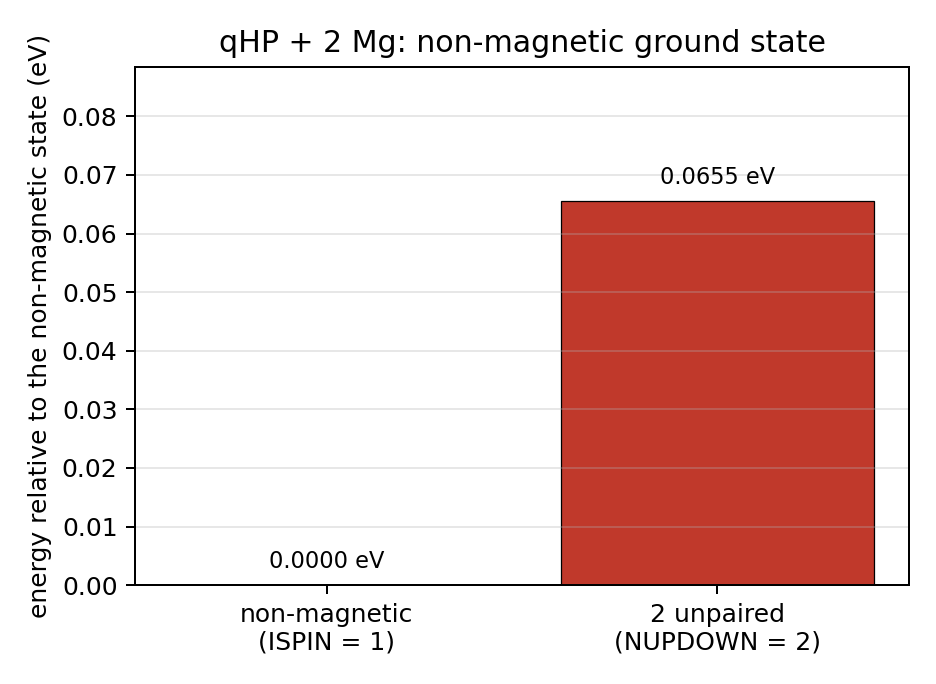
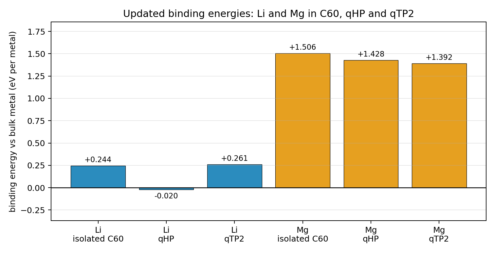
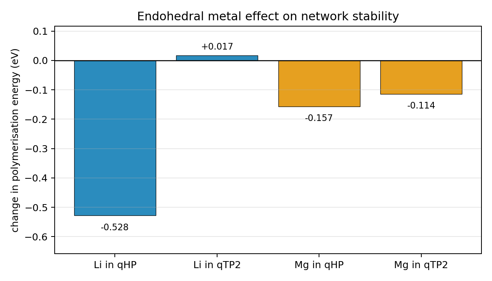

# Round 2 results, 2026-11-19: qHP Mg spin states and the [Li@C60]+ calibration

**Completing the two open branches of the 2026-11-18 pilot**

Version 1.0 — 21 November 2026

Related material: the pilot report is in
[../pilot_2026-11-18/report/pilot_2026-11-18_results.md](../pilot_2026-11-18/report/pilot_2026-11-18_results.md);
the audit and feasibility report is in
[../../report/endohedral_c60_network_feasibility_report.md](../../report/endohedral_c60_network_feasibility_report.md).

---

## 0. Summary

Round 2 contains three calculations, all completed:

1. **13** - qHP network with Mg in both cages, restarted from the cancelled pilot case 05,
   non-magnetic (ISPIN = 1).
2. **14** - the same restart with a fixed moment of 2 uB (NUPDOWN = 2).
3. **15** - the closed-shell [Li@C60]+ cation (NELECT = 240), the direct experimental
   calibration for the endohedral Li position.

All three terminate normally, with no SCF step at NELM, final forces below the 0.02 eV/A
threshold, the expected bond counts (188 for qHP, 90 for C60) and small in-plane stress.

**Key results:**

- **The qHP Mg ground state is non-magnetic.** Case 13 is 0.0655 eV below case 14. Both
  Mg atoms relax to the cage centres (0.014 and 0.014 A) with nearly uniform Mg-C distances
  (3.47-3.88 A). The 0.47 A displacement seen after 27 steps in the cancelled pilot run was
  not converged; the restarted runs settle at the centre.
- **The Li+ calibration passes.** In the closed-shell cation Li sits 1.479 A off the cage
  centre with a Li-C minimum of 2.285 A, essentially identical to the neutral Li@C60 case
  (1.497 A, 2.260 A). The closed-shell cation has a moment of exactly 0.00 uB.
- **Updated binding energies (PBE+D3, relative to bulk metal):** Li in qHP -0.020 eV;
  Li in isolated C60 +0.244; Li in qTP2 +0.261; Mg in qHP +1.428; Mg in qTP2 +1.392;
  Mg in isolated C60 +1.506. Li is therefore about 1.45 eV per atom more favourable than Mg
  in the qHP network, and qHP is the best of the three hosts for Li.
- **Both metals make network polymerisation more favourable,** but the effect is much
  larger for Li in qHP (-0.528 eV per two cages) than for Mg in qHP (-0.157 eV), Li in
  qTP2 (+0.017 eV) or Mg in qTP2 (-0.114 eV).

The same caveats as in the pilot still apply: the bulk-metal references include D3(BJ), no
free-atom references were calculated, everything is at 0 K, the qHP reference is the older
ring-opened model, and no exohedral competitors have been computed yet. The cation energy
is from a charged cell and is not used as a binding energy.

---

## 1. Runs and settings

| Case | Purpose | Spin treatment |
|---|---|---|
| 13 | qHP Mg restart, non-magnetic | ISPIN = 1 |
| 14 | qHP Mg restart, fixed moment | ISPIN = 2, NUPDOWN = 2, MAGMOM = 120*0.0 2*1.0 |
| 15 | [Li@C60]+ cation check | ISPIN = 2, NUPDOWN = 0, NELECT = 240 |

All other settings follow the pilot: PBE + D3(BJ), ENCUT 520 eV, ISYM = 0,
EDIFF = 1E-5, EDIFFG = -0.02 eV/A, NELM = 300. Cases 13 and 14 restart from the pilot
CONTCAR of case 05, use ISIF = 3 with LATTICE_CONSTRAINTS = .TRUE. .TRUE. .FALSE.
(c = 25.0 A fixed), IDIPOL = 3 and SIGMA = 0.05 eV, and add KPAR = 4 (parallelisation
only; the total energies are unchanged). Case 15 uses the 22 A box, Gamma point,
SIGMA = 0.005 eV and IDIPOL = 4.

The POTCARs are the same as in the pilot (C and Mg for 13/14; C and Li for 15).
POTCAR files are not included in the repository.

---

## 2. Results

### 2.1 qHP Mg: spin state and geometry

Both restarts converge cleanly:

| Case | E(sigma->0) (eV) | Moment (uB) | Mg displacement (A) | Mg-C min (A) | Cell a / b (A) | stress XX / YY (kB) |
|---|---|---|---|---|---|---|
| 13, non-magnetic | -1073.17263 | 0 (ISPIN = 1) | 0.014 / 0.014 | 3.473 / 3.475 | 9.145 / 15.889 | +0.015 / +0.027 |
| 14, 2 unpaired | -1073.10716 | 2.00 | 0.022 / 0.022 | 3.484 / 3.485 | 9.149 / 15.901 | -0.084 / -0.080 |

*Figure 3. Relative energy of the two qHP Mg spin states. The non-magnetic state is the
ground state by 0.0655 eV.*

The non-magnetic state is lower by 0.0655 eV. This is consistent with the isolated-cage
result, where the Mg@C60 singlet was 0.699 eV below the triplet, and with the closed-shell
2+ picture of Mg inside the cage. Both Mg atoms sit at their cage centres, with a nearly
uniform Mg-C distance of about 3.58 A, so the metal is not bound to the cage wall.

The restarted geometry also resolves the pilot case 05: after 27 steps that run had Mg at
0.47 A from the centre with a large residual force (1.64 eV/A); the converged restarts place
both Mg atoms at 0.014-0.022 A.

### 2.2 The [Li@C60]+ calibration

| Quantity | Neutral Li@C60 (pilot 01) | [Li@C60]+ (round 2, case 15) |
|---|---|---|
| Electrons | 241 | 240 |
| Final moment | 1.000 uB | 0.000 uB |
| Li displacement from centre | 1.497 A | 1.479 A |
| Li-C minimum | 2.260 A | 2.285 A |
| C-C bonds / coordination | 90 / all 3 | 90 / all 3 |

The cation reproduces the off-centre Li position of the neutral radical and of the
experimental Li+@C60 salts, with a closed-shell moment of exactly zero. This is the direct
calibration check that the earlier 32-metal centre-start screen could not provide.

**Energy note.** Case 15 is a charged cell (NELECT = 240, net charge +1) with a
homogeneous background. Its total energy is not directly comparable with the neutral
runs: E(15) - E(REF C60) = +4.063 eV, and E(15) - E(neutral Li@C60) = +5.895 eV. Neither
number is a physical binding energy without a Li+ reference and a charged-cell correction,
so only the geometry and the moment are used here. A proper cation binding energy would
require E(Li+) in the same box and a finite-size correction.

### 2.3 Updated binding and polymerisation energies

All energies are energy(sigma->0). The binding energy is relative to bulk metal
(Li -2.07638 eV/atom, Mg -1.79722 eV/atom); positive values mean the endohedral state is
metastable against phase separation.

| System | Binding per metal (eV) | Change in polymerisation energy (eV) |
|---|---|---|
| Li in isolated C60 | +0.244 | - |
| Li in qHP | **-0.020** | **-0.528** (two cages) |
| Li in qTP2 | +0.261 | +0.017 (one cage) |
| Mg in isolated C60 | +1.506 | - |
| Mg in qHP | **+1.428** | **-0.157** (two cages) |
| Mg in qTP2 | +1.392 | -0.114 (one cage) |

*Figure 1. Updated binding energies for Li and Mg in the three hosts. Positive means
metastable with respect to the metal plus the empty host.*

*Figure 2. Effect of the encapsulated metal on the polymerisation energy. Negative means
the metal stabilises the network relative to isolated M@C60 units.*

The picture is now complete for the two pilot metals:

- **Li in qHP is essentially thermoneutral with bulk Li (-0.020 eV)** and is the only
  system in this set that is not clearly metastable. Li in isolated C60 and in qTP2 is
  metastable by about a quarter of an eV.
- **Mg is metastable by about 1.4-1.5 eV in all three hosts**, with qTP2 marginally the
  best and isolated C60 the worst. The differences between hosts are small compared with
  the overall metastability.
- **The Li-Mg difference in qHP is about 1.45 eV per metal.** Within this data set, Li is
  by far the more promising endohedral dopant for the qHP network.
- **Li strongly favours qHP polymerisation** (-0.53 eV per two cages), while Mg favours it
  only weakly (-0.16 eV), and Li on qTP2 is neutral.

---

## 3. What round 2 establishes, and what it does not

**Establishes:**

1. The qHP Mg branch is complete and converged. The ground state is non-magnetic, Mg sits
   at the cage centre, and the network is intact (188 C-C bonds, 16 four-coordinated
   carbons, longest bond 1.613 A).
2. The Li+@C60 calibration passes: closed-shell cation, off-centre Li at 1.479 A, moment
   exactly zero.
3. The two-metal comparison is now complete for Li and Mg across the isolated cage, qHP
   and qTP2. Li in qHP is the standout candidate; Mg is metastable by about 1.4-1.5 eV in
   every host tested.
4. Endohedral Li (and, weakly, Mg) makes qHP polymerisation more favourable, which is a
   positive sign for a synthesis route that starts from M@C60 units.

**Does not establish:**

1. **Site preference.** No exohedral competitor has been computed, so the decisive
   endohedral-versus-exohedral energy is still unknown.
2. **Finite-temperature survival.** All calculations are 0 K relaxations.
3. **Quantitative binding.** The bulk references include D3(BJ) and are not fully
   converged, and no free-atom reference exists. The binding numbers are +/-0.1-0.2 eV
   estimates.
4. **The qHP model.** The qHP reference is the older ring-opened structure; its
   polymerisation energy is small (-0.13 eV per two cages), so the Li stabilisation of qHP
   may be partly a property of that model.
5. **The cation energy.** Charged-cell effects are not corrected, so only the geometry of
   case 15 is used.
6. **The remaining 28 metals.** Nothing is known about them beyond the original screen.

---

## 4. Updated next steps

The pilot's first two next steps (qHP Mg and the Li+ check) are now done. The rest of the
plan is unchanged and is the critical path:

1. **Recompute the bulk-metal references without D3** (IVDW = 0) and with a tighter cell
   relaxation, and add free-atom references. Recompute the binding table.
2. **Add the exohedral competitors** at the same composition (settings matched to this
   work). The deciding quantity is E(endohedral) - E(exohedral) per metal.
3. **AIMD at 800-1000 K** for Li@qHP and Mg@qHP/qTP2, with the pristine network as the
   baseline, tracking the C-C bond count, carbon coordination and metal-cage distance.
4. **Re-check the qHP reference**; if the intended phase is the defect-free [2+2] polymer,
   rebuild it and repeat the qHP branch.
5. **Only then run the remaining 28 metals**, with Li as the reference case and the
   candidate rule from the pilot report.

A practical shortlist from the combined data: Li@qHP first, Mg as the second endohedral
case for comparison (it is metastable but makes a clean closed-shell, centred control),
and qTP2 as the second host for Li.

---

## 5. Data and reproduction

    round2_2026-11-19/
        README.md
        report/round2_2026-11-19_results.md     this document
        data/round2_summary.csv / .json         machine-readable results
        data/round2_table.md                    Appendix A, generated
        figures/fig1..fig3                      binding, polymerisation, spin states
        calculations/<case>/                    INCAR, POSCAR, KPOINTS, OSZICAR,
                                                CONTCAR, OUTCAR.gz, input record,
                                                POTCAR_SPEC, Slurm files
        audit/                                  original inventory and Slurm status
        docs/                                   original input README and package notes
        scripts/analyze_round2.py               re-derives data/round2_summary.*
        scripts/make_round2_figures.py          re-draws the figures
        scripts/make_round2_table.py            re-renders Appendix A

Reproduce with:

    cd round2_2026-11-19
    python scripts/analyze_round2.py
    python scripts/make_round2_table.py
    python scripts/make_round2_figures.py

The round-2 scripts import the shared parsers from
../pilot_2026-11-18/scripts/analyze_pilot.py and read the pilot reference energies from
../pilot_2026-11-18/data/pilot_summary.json, so the two rounds always use the same
definitions.

POTCAR, WAVECAR and CHGCAR are not included (VASP licence and size). OUTCAR files are
gzip-compressed.

---

## Appendix A - run table

Generated from data/round2_summary.csv by scripts/make_round2_table.py.

| Case | Complete | E(sigma->0) (eV) | Fmax (eV/A) | mag (uB) | n_ion | SCF@NELM | metal disp (A) | M-C min (A) | n_CC | stress XX/YY (kB) | Note |
|---|---|---|---|---|---|---|---|---|---|---|---|
| 13_qHP_network_Mg_inside_cage_restart_nonmagnetic | yes | -1073.17263 | 0.0188 | n/a | 36 | 0 | 0.014 / 0.014 | 3.473 / 3.475 | 188 | 0.015 / 0.027 | ground state; both Mg centred |
| 14_qHP_network_Mg_inside_cage_restart_2unpaired | yes | -1073.10716 | 0.0192 | 2.00 | 38 | 0 | 0.022 / 0.022 | 3.484 / 3.485 | 188 | -0.084 / -0.080 | +65 meV above 13; both Mg centred |
| 15_isolated_C60_Li_cation_inside_check | yes | -532.08726 | 0.0172 | 0.00 | 40 | 0 | 1.479 | 2.285 | 90 | -0.144 / -0.147 | closed-shell cation; Li+ off-centre |

---

## Appendix B - definitions

- **Binding energy:** for the isolated cage, E(M@C60) - E(C60) - E(bulk metal, per atom);
  for a network, [E(host + n M) - E(host) - n E(bulk metal, per atom)] / n, with n = 2 for
  qHP and n = 1 for qTP2. Positive means metastable against phase separation.
- **Change in polymerisation energy:** [E(host + n M) - n E(M@C60)] - [E(host) - n E(C60)].
  Negative means the metal stabilises the network.
- **Metal displacement:** distance from the metal to the centroid of the 60 carbons of its
  cage, using periodic images; the cage is assigned from the starting geometry.
- **Bond count and coordination:** minimum-image C-C distances with a 1.80 A cutoff.
