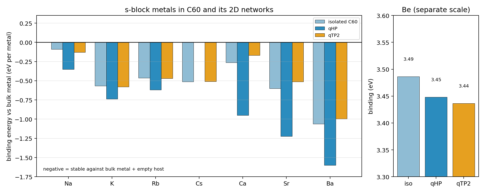
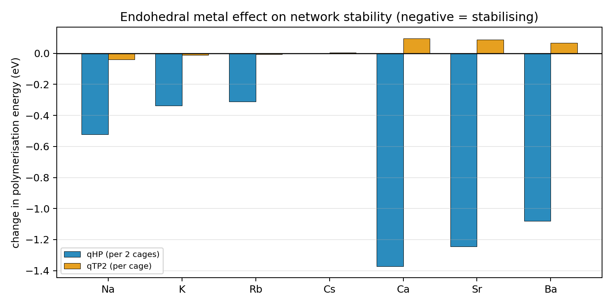
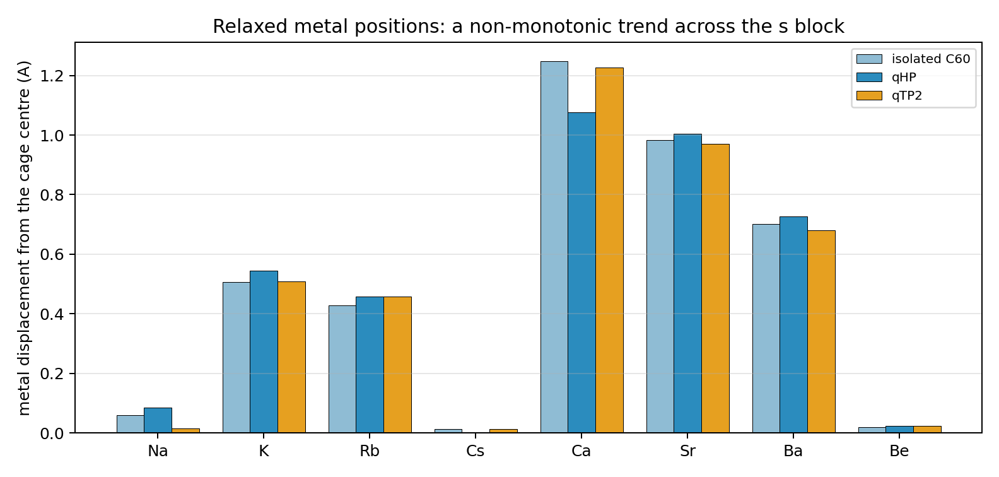
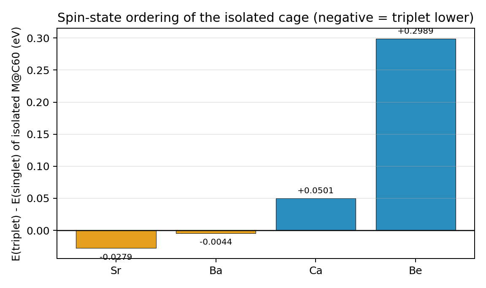

# Round 3a results, 2026-11-23: s-block metals in C60 and the qHP/qTP2 networks

> **Note (review, 2026-11-23):** the caveats below about a "ring-opened" qHP reference, removing D3
> from the bulk references only, and free-atom references are outdated; see
> [PROJECT_STATUS.md](../../PROJECT_STATUS.md) sections 4.3 and 5. For K, Rb, Cs, Ca, Sr and Ba the binding energies
> become *more* negative without D3 (consistent PBE-only column: `scripts/d3_split_and_trends.py`).

**The first full metal series: Na, K, Rb, Cs, Ca, Sr, Ba and Be inside the isolated cage and the two 2D networks**

Version 1.0 — 23 November 2026

Related material: the pilot and round-2 reports are in
[../pilot_2026-11-18/report/pilot_2026-11-18_results.md](../pilot_2026-11-18/report/pilot_2026-11-18_results.md)
and [../round2_2026-11-19/report/round2_2026-11-19_results.md](../round2_2026-11-19/report/round2_2026-11-19_results.md);
the earlier audit and feasibility report is in
[../../report/endohedral_c60_network_feasibility_report.md](../../report/endohedral_c60_network_feasibility_report.md).

---

## 0. Summary

Round 3a contains 35 calculations for the eight s-block metals Na, K, Rb, Cs, Ca, Sr, Ba and Be:
one bulk reference, one or two isolated M@C60 spin states, and the qHP and qTP2 networks.
The Cs qHP run finished too late and is excluded from the delivered set; it is the only missing
branch. All 35 delivered calculations terminate normally, have no SCF step at NELM, and have final
maximum forces between 0.0139 and 0.0197 eV/A.

**Key results:**

1. **All s-block metals except Be are thermodynamically stable inside C60 with respect to bulk metal.**
   The binding energy per metal (negative = stable against decomposition into bulk metal plus the
   empty host) is: Ba -1.06 (isolated) / -1.60 (qHP) / -0.99 (qTP2); Sr -0.60 / -1.22 / -0.51;
   K -0.57 / -0.74 / -0.58; Cs -0.51 / n.a. / -0.51; Rb -0.46 / -0.62 / -0.47;
   Ca -0.26 / -0.95 / -0.17; Na -0.09 / -0.35 / -0.13. Be is the outlier, metastable by +3.44 to
   +3.49 eV.
2. **qHP is the best host for every metal in this series.** For Ca, Sr and Ba the qHP binding is
   much stronger than for qTP2 or the isolated cage (e.g. Ba: -1.60 in qHP versus -0.99 in qTP2).
3. **Endohedral metals strongly stabilise qHP polymerisation, and much less so qTP2.**
   The change in polymerisation energy is Ca -1.37, Sr -1.24, Ba -1.08, Na -0.52, K -0.34,
   Rb -0.31, Be -0.08 eV per two qHP cages; for qTP2 the values are within +/-0.10 eV of zero
   for all metals.
4. **The relaxed metal position is non-monotonic across the s block.** Na (0.06 A) and Cs (0.01 A)
   stay essentially at the cage centre; K and Rb sit about 0.43-0.55 A off-centre; Ca, Sr and Ba sit
   0.68-1.25 A off-centre, bound to the cage wall. Be is centred in the singlet ground state
   (0.02 A) but its higher-lying triplet is 1.91 A off-centre.
5. **The isolated-cage spin ordering is subtle.** Be and Ca prefer the singlet (by 0.299 and
   0.050 eV); Sr and Ba prefer the 2-unpaired state (by 0.028 and 0.004 eV). The Ca/Sr/Ba network
   runs were non-magnetic (ISPIN = 1); given these small splittings, the magnetic state of the
   Sr and Ba networks should be checked.
6. **All cages and networks survive.** Isolated cages keep 90 C-C bonds, qHP keeps 188 and qTP2
   keeps 94, with the same coordination pattern as the pristine references; the longest C-C bond is
   1.626 A; every metal passes the convex-hull test; the network in-plane stress is below 0.1 kB.

These results change the candidate picture substantially: the heavy alkaline earths Ca, Sr and Ba
are, within this data set, the strongest endohedral qHP candidates, both thermodynamically and in
their effect on polymerisation, followed by Na and Li; K and Rb are intermediate; Mg is metastable
and Be is not a candidate under the bulk-metal reference. The caveats in Section 5, in particular
the D3-containing bulk references and the ring-opened qHP model, must be kept in mind before this
ranking is used for synthesis decisions.

---

## 1. Runs and methods

Each metal has:

- 0_REF_<M>_bulk_metal: the bulk reference (bcc for Na, K, Rb, Cs, Ba; hcp for Be; fcc for Ca, Sr).
- 1_isolated_C60_<M>_inside[_0unpaired|_2unpaired]: the metal inside an isolated C60. Na, K, Rb
  and Cs have one spin state (doublet); Be, Ca, Sr and Ba have both the singlet and the 2-unpaired
  state.
- 2_qHP_<M>_inside_cage: 120 C + 2 metals (one per cage), c = 25 A fixed, in-plane relaxation only.
- 2_qTP2_<M>_inside_cage: 60 C + 1 metal, same cell protocol.

The settings are those of the pilot: PBE + D3(BJ), ENCUT 520 eV, ISYM = 0 for the molecular and
network runs, EDIFF = 1E-5, EDIFFG = -0.02 eV/A, NELM = 300, SIGMA = 0.005 eV (isolated) or
0.05 eV (networks), IDIPOL = 4 (isolated) or 3 (networks). The network runs add KPAR = 4
(parallelisation only; the total energies are unchanged). Bulk runs use KSPACING 0.12,
Methfessel-Paxton smearing 0.1 eV and the energy criterion EDIFFG = 1E-4 eV. The bulk runs still
include D3(BJ), IVDW = 12.

Reference energies are taken from the pilot, which used identical settings:
E(C60) = -536.150272 eV, E(qHP) = -1072.433489 eV, E(qTP2) = -536.751538 eV.
POTCAR files are excluded from the repository (VASP licence); the dataset titles of every case are
recorded in audit/potcar_titles.txt.

---

## 2. Results

### 2.1 Stability with respect to the bulk metal

The binding energy is E(M@host) - E(host) - n E(bulk metal), divided by n (n = 2 for qHP, 1 for
qTP2 and the isolated cage). Negative means the endohedral state is below the phase-separated
state of bulk metal plus the empty host.

| Metal | E_bulk/atom (eV) | best iso spin | binding iso (eV) | binding qHP (eV) | binding qTP2 (eV) | poly qHP (eV/2 cages) | poly qTP2 (eV/cage) | disp iso (A) | disp qHP (A) | disp qTP2 (A) | note |
|---|---|---|---|---|---|---|---|---|---|---|---|
| Na | -1.4689 | doublet (1) | -0.090 | -0.351 | -0.130 | -0.523 | -0.040 | 0.059 | 0.086 | 0.015 | weakly stable; nearly centred |
| K | -1.1639 | doublet (1) | -0.567 | -0.736 | -0.579 | -0.338 | -0.011 | 0.508 | 0.545 | 0.508 | stable; off-centre 0.5 A |
| Rb | -1.0405 | doublet (1) | -0.462 | -0.618 | -0.469 | -0.311 | -0.007 | 0.429 | 0.459 | 0.458 | stable; off-centre 0.45 A |
| Cs | -0.9437 | doublet (1) | -0.513 | n/a | -0.508 | n/a | 0.006 | 0.014 | n/a | 0.012 | stable; centred; qHP run excluded (stalled) |
| Ca | -2.1642 | singlet (0) | -0.263 | -0.949 | -0.168 | -1.373 | 0.095 | 1.248 | 1.076 | 1.227 | stable, strongly favours qHP; off-centre 1.1-1.25 A |
| Sr | -1.8389 | 2 unpaired | -0.601 | -1.223 | -0.513 | -1.244 | 0.087 | 0.984 | 1.003 | 0.970 | stable, strongly favours qHP; off-centre 1.0 A |
| Ba | -2.1115 | 2 unpaired | -1.061 | -1.601 | -0.994 | -1.081 | 0.066 | 0.703 | 0.727 | 0.681 | most stable; off-centre 0.7 A |
| Be | -4.1332 | singlet (0) | 3.486 | 3.448 | 3.437 | -0.077 | -0.050 | 0.019 | 0.023 | 0.023 | strongly metastable vs bulk Be; singlet centred, triplet at 1.91 A |

*Figure 1. Binding energies of the s-block metals in the isolated cage and the two networks.
Negative values mean stable against bulk metal plus empty host. Be is shown on a separate scale;
its qHP bar is absent for Cs because the Cs qHP run is not included.*

The trend is clear: the heavier alkali and alkaline-earth metals are stable inside C60, and the
divalent metals are most strongly bound in the qHP network (Ba -1.60, Sr -1.22, Ca -0.95 eV per
metal). Be is strongly metastable with respect to bulk Be (+3.4 eV); its high cohesive energy and
high ionisation energies make endohedral Be unfavourable in this reference.

Part of the trend comes from the bulk reference: the cohesive energies decrease from Li/Mg to
Cs/Ba, so the same endohedral interaction produces a more negative binding for the heavier metals.
The values should therefore be read as "stability against decomposition into the metal's bulk
phase", not as a direct ranking of cage affinity. A free-atom reference (not computed here) is
needed for that.

### 2.2 Network preference and the effect on polymerisation

Two robust observations follow from the network energies:

- **qHP is the preferred host.** For every metal with a qHP run, the qHP binding is more negative
  than the qTP2 binding (typically by 0.1-0.6 eV per metal), and much more negative than the
  isolated-cage binding.
- **The encapsulated metal stabilises qHP polymerisation.** The change in polymerisation energy
  (the energy to assemble the doped network from isolated M@C60 units, minus the same quantity for
  pristine C60) is negative for every metal, and large for the divalent metals:

| Metal | change in qHP polymerisation (eV per 2 cages) | change in qTP2 polymerisation (eV per cage) |
|---|---|---|
| Ca | -1.373 | +0.095 |
| Sr | -1.244 | +0.087 |
| Ba | -1.081 | +0.066 |
| Na | -0.523 | -0.040 |
| K | -0.338 | -0.011 |
| Rb | -0.311 | -0.007 |
| Be | -0.077 | -0.050 |
| Cs | n.a. (qHP excluded) | +0.006 |

*Figure 2. Change in the polymerisation energy caused by the encapsulated metal. Negative means the
doped network is stabilised relative to isolated M@C60; qHP is per two cages and qTP2 per cage.*

The divalent metals Ca, Sr and Ba lower the qHP polymerisation energy by more than 1 eV per two
cages, which is a strong electronic driving force for forming the network once M@C60 units are
available. qTP2 is essentially neutral for all metals.

### 2.3 Metal positions

*Figure 3. Relaxed metal displacement from the cage centre in the three hosts. Na and Cs remain
near the centre; K and Rb sit at about 0.5 A; Ca, Sr and Ba bind to the cage wall at 0.7-1.25 A.
The Be bar is the singlet ground state; its triplet is 1.91 A off-centre.*

The metal-carbon minimum distances follow the same pattern:

| Metal | M-C minimum, isolated (A) | M-C minimum, qHP (A) | M-C minimum, qTP2 (A) |
|---|---|---|---|
| Na | 3.49 | 3.45 | 3.52 |
| K | 3.09 | 3.06 | 3.04 |
| Rb | 3.17 | 3.12 | 3.10 |
| Cs | 3.54 | n.a. | 3.52 |
| Ca | 2.42 | 2.43 | 2.42 |
| Sr | 2.71 | 2.66 | 2.64 |
| Ba | 2.91 | 2.90 | 2.90 |
| Be (singlet) | 3.54 | 3.49 | 3.50 |

The short Ca/Sr/Ba distances (2.4-2.9 A) indicate a real chemical interaction with the cage wall,
not a centred ionic state. Na and Cs remain nearly centred with M-C about 3.5 A.

### 2.4 Spin states

The isolated cage was computed in both spin states for the four metals with a closed-shell
candidate:

| Metal | E(triplet) - E(singlet) (eV) | ground state |
|---|---|---|
| Be | +0.2989 | singlet |
| Ca | +0.0501 | singlet |
| Ba | -0.0044 | 2-unpaired |
| Sr | -0.0279 | 2-unpaired |

*Figure 4. Spin-state ordering of the isolated cage. Negative values mean the 2-unpaired state is
lower.*

The splittings for Ba and Sr are small (4 and 28 meV). The Ca/Sr/Ba network runs were therefore
started non-magnetic (ISPIN = 1); for Sr and Ba the magnetic state of the network should be checked,
because the isolated cage already prefers the 2-unpaired state. For Be and Ca the singlet is
clearly lower.

### 2.5 Cage and network integrity

All delivered runs preserve the carbon framework:

- Isolated cages: 90 C-C bonds, every carbon three-coordinated, longest bond 1.46-1.48 A.
- qHP: 188 C-C bonds, 16 four-coordinated carbons, no two-coordinated carbons, longest bond
  1.605-1.626 A.
- qTP2: 94 C-C bonds, 8 four-coordinated carbons, longest bond 1.598-1.604 A.
- Every metal is inside the convex hull of its cage.
- Network cells: c = 25.0 A in every run; in-plane stress below 0.1 kB in every network run.

There is no sign of cage opening, carbide formation or metal escape in any of the 35 calculations.

---

## 3. What round 3a establishes, and what it does not

**Establishes:**

1. The s-block series is complete at the level of the delivered set, with a consistent protocol and
   a single set of reference energies.
2. All s-block metals except Be are thermodynamically stable inside C60 with respect to bulk metal,
   and the divalent Ca/Sr/Ba are most strongly bound in qHP.
3. Endohedral metals stabilise qHP polymerisation, strongly for Ca/Sr/Ba and moderately for
   Na/K/Rb; qTP2 is not significantly affected.
4. The relaxed metal position varies non-monotonically with the metal, and the short Ca/Sr/Ba
   metal-carbon distances show a chemical interaction with the cage wall.
5. The cage and both networks survive one metal per cage for all eight metals at 0 K.

**Does not establish:**

1. **Endohedral versus exohedral preference.** No exohedral or interstitial competitor has been
   computed. A negative binding against bulk metal does not mean that the metal prefers the cage
   interior over an interstitial site of the network.
2. **Finite-temperature survival.** All calculations are 0 K relaxations.
3. **Quantitative binding.** The bulk references still include D3(BJ) and are not fully relaxed
   (several bulk cells carry 0.2-0.6 kB stress and are 1.5-4 percent smaller than typical PBE
   lattice constants). This makes the reported binding energies conservative (less negative than
   they would be with a proper bulk reference), but the absolute values carry an uncertainty of
   roughly 0.1-0.2 eV per metal.
4. **Free-atom reference.** Without it, the binding energies cannot be used to rank the intrinsic
   cage affinity across metals.
5. **The qHP model.** The qHP reference is the older ring-opened structure; its polymerisation
   energy relative to isolated C60 is only -0.13 eV per two cages. The strong qHP stabilisation by
   Ca/Sr/Ba should be re-checked with a defect-free qHP model.
6. **Magnetic state of the networks.** Ca/Sr/Ba networks were run non-magnetic; Sr and Ba deserve
   a spin-polarised check.
7. **The Cs qHP branch** is missing (stalled run, excluded from the bundle).
8. **The 3d/4d metals** are not part of this round.

---

## 4. Updated candidate picture

Combining this round with the pilot (Li) and round 2 (Mg):

| Metal | binding qHP (eV, vs bulk) | qHP polymerisation effect (eV/2 cages) | comment |
|---|---|---|---|
| Ba | -1.601 | -1.081 | strongest thermodynamic candidate; large ion, 0.7 A off-centre |
| Sr | -1.223 | -1.244 | strong on both counts; 1.0 A off-centre |
| Ca | -0.949 | -1.373 | strongest polymerisation effect; 1.1-1.25 A off-centre |
| K | -0.736 | -0.338 | stable; 0.5 A off-centre |
| Rb | -0.618 | -0.311 | stable; 0.45 A off-centre |
| Na | -0.351 | -0.523 | moderately stable; nearly centred |
| Li | -0.020 | -0.528 | marginal vs bulk Li; off-centre 1.33 A (pilot) |
| Cs | n.a. | n.a. | stable in qTP2 and isolated; qHP missing |
| Mg | +1.428 | -0.157 | metastable vs bulk Mg (round 2) |
| Be | +3.448 | -0.077 | not a candidate under the bulk reference |

The strongest qHP candidates on the two independent criteria (stability vs bulk, and qHP
stabilisation) are **Ca, Sr and Ba**; **Na** is next; **K and Rb** are intermediate; **Li** is
marginal against bulk Li; **Mg** is metastable; **Be** is excluded.

This is a hypothesis for the next step, not a synthesis claim. The decisive missing calculation is
still the competition with exohedral/interstitial sites, which is expected to be strong for the
large Ca/Sr/Ba ions. The experimental fact that only Li@C60 and Na@C60 have been isolated is a
warning that kinetics and formation pathways matter as much as the 0 K thermodynamics.

---

## 5. Caveats

1. **Bulk references include D3(BJ).** The bulk cells are 1.5-4 percent smaller than typical PBE
   lattice constants and several carry 0.2-0.6 kB stress. D3 over-binds the metals, so the
   reported binding energies are conservative (the true stability is likely stronger). A
   D3-free bulk reference and a free-atom reference should be computed before the ranking is
   finalised.
2. **qHP model.** The ring-opened reference structure may bias the qHP polymerisation energies.
3. **0 K only.** No AIMD, no entropy, no vibrational free energy.
4. **No exohedral competitor.** The endohedral-vs-exohedral energy difference is the decisive
   number and is not yet available.
5. **Network magnetic state.** Ca/Sr/Ba networks are non-magnetic; Sr/Ba have a small triplet
   preference in the isolated cage.
6. **Cs qHP missing.**
7. **Only s-block metals.**

---

## 6. Next steps

1. **Compute the exohedral competitors** at the same composition and settings (the 40-metal
   intercalation structures already exist). The deciding quantity is
   E(endohedral) - E(exohedral) per metal.
2. **Recompute the bulk references without D3** and add free-atom references; rebuild the binding
   table.
3. **Spin-polarised checks** for Sr and Ba networks.
4. **Re-run the Cs qHP branch** and, if needed, the stalled case.
5. **AIMD at 800-1000 K** for the leading candidates (Ca/Sr/Ba in qHP, Na/Li in qHP as controls)
   with the pristine network as the baseline.
6. **Re-check the qHP reference model** (defect-free [2+2] polymer) before the Ca/Sr/Ba qHP
   stabilisation is used quantitatively.
7. Only then extend to the 3d/4d metals.

---

## 7. Data and reproduction

    round3a_2026-11-23/
        README.md
        report/round3a_2026-11-23_results.md    this document
        data/round3a_cases.csv / .json          per-case results
        data/round3a_per_metal.csv / .json      per-metal summary
        data/round3a_per_metal.md               Appendix A, generated
        data/round3a_cases.md                   Appendix B, generated
        figures/fig1..fig4                      binding, polymerisation, positions, spins
        calculations/<M>/<case>/                INCAR, POSCAR, KPOINTS, OSZICAR, CONTCAR,
                                                OUTCAR.gz, vasp.log, Slurm files
        audit/                                  original inventory, provenance note,
                                                POTCAR dataset titles (no POTCAR content)
        docs/README_package.txt                 original round-3a provenance note
        scripts/analyze_round3a.py              re-derives the data files
        scripts/make_round3a_tables.py          re-renders the tables
        scripts/make_round3a_figures.py         re-draws the figures

Reproduce with:

    cd round3a_2026-11-23
    python scripts/analyze_round3a.py
    python scripts/make_round3a_tables.py
    python scripts/make_round3a_figures.py

The analysis script imports the shared parsers from
../pilot_2026-11-18/scripts/analyze_pilot.py and the reference energies from
../pilot_2026-11-18/data/pilot_summary.json.

POTCAR, WAVECAR and CHGCAR are not included. OUTCAR files are gzip-compressed and unmodified.
The bulk runs still use D3(BJ) (IVDW = 12), as described in Section 5.

---

## Appendix A - per-metal summary

Generated from data/round3a_per_metal.csv by scripts/make_round3a_tables.py. Binding energies are
per metal and relative to bulk metal; negative = stable against bulk metal plus the empty host.

| Metal | E_bulk/atom (eV) | best iso spin | binding iso (eV) | binding qHP (eV) | binding qTP2 (eV) | poly qHP (eV/2 cages) | poly qTP2 (eV/cage) | disp iso (A) | disp qHP (A) | disp qTP2 (A) | note |
|---|---|---|---|---|---|---|---|---|---|---|---|
| Na | -1.4689 | doublet (1) | -0.090 | -0.351 | -0.130 | -0.523 | -0.040 | 0.059 | 0.086 | 0.015 | weakly stable; nearly centred |
| K | -1.1639 | doublet (1) | -0.567 | -0.736 | -0.579 | -0.338 | -0.011 | 0.508 | 0.545 | 0.508 | stable; off-centre 0.5 A |
| Rb | -1.0405 | doublet (1) | -0.462 | -0.618 | -0.469 | -0.311 | -0.007 | 0.429 | 0.459 | 0.458 | stable; off-centre 0.45 A |
| Cs | -0.9437 | doublet (1) | -0.513 | n/a | -0.508 | n/a | 0.006 | 0.014 | n/a | 0.012 | stable; centred; qHP run excluded (stalled) |
| Ca | -2.1642 | singlet (0) | -0.263 | -0.949 | -0.168 | -1.373 | 0.095 | 1.248 | 1.076 | 1.227 | stable, strongly favours qHP; off-centre 1.1-1.25 A |
| Sr | -1.8389 | 2 unpaired | -0.601 | -1.223 | -0.513 | -1.244 | 0.087 | 0.984 | 1.003 | 0.970 | stable, strongly favours qHP; off-centre 1.0 A |
| Ba | -2.1115 | 2 unpaired | -1.061 | -1.601 | -0.994 | -1.081 | 0.066 | 0.703 | 0.727 | 0.681 | most stable; off-centre 0.7 A |
| Be | -4.1332 | singlet (0) | 3.486 | 3.448 | 3.437 | -0.077 | -0.050 | 0.019 | 0.023 | 0.023 | strongly metastable vs bulk Be; singlet centred, triplet at 1.91 A |

---

## Appendix B - per-case table

Generated from data/round3a_cases.csv. The Cs qHP run is absent (excluded from the delivered
bundle); all other 35 cases are listed.

| Case | Complete | E(sigma->0) (eV) | Fmax (eV/A) | mag (uB) | N_ion | n_CC | bond max (A) | stress XX/YY (kB) | metal disp (A) | M-C min (A) |
|---|---|---|---|---|---|---|---|---|---|---|
| Ba/0_REF_Ba_bulk_metal | yes | -2.11147 | 0.0000 | n/a | 4 | - | n/a | -0.090 / -0.090 | n/a | n/a |
| Ba/1_isolated_C60_Ba_inside_0unpaired | yes | -539.31822 | 0.0139 | -0.00 | 68 | 90 | 1.478 | -0.060 / -0.089 | 0.709 | 2.915 |
| Ba/1_isolated_C60_Ba_inside_2unpaired | yes | -539.32267 | 0.0179 | 2.00 | 26 | 90 | 1.459 | -0.066 / -0.017 | 0.703 | 2.942 |
| Ba/2_qHP_Ba_inside_cage | yes | -1079.85919 | 0.0158 | n/a | 48 | 188 | 1.626 | 0.023 / -0.040 | 0.727 / 0.726 | 2.905 / 2.902 |
| Ba/2_qTP2_Ba_inside_cage | yes | -539.85748 | 0.0158 | n/a | 24 | 94 | 1.602 | -0.065 / -0.063 | 0.681 | 2.903 |
| Be/0_REF_Be_bulk_metal | yes | -8.26638 | 0.0000 | n/a | 5 | - | n/a | -0.518 / -0.518 | n/a | n/a |
| Be/1_isolated_C60_Be_inside_0unpaired | yes | -536.79707 | 0.0177 | 0.00 | 46 | 90 | 1.455 | -0.071 / -0.066 | 0.019 | 3.536 |
| Be/1_isolated_C60_Be_inside_2unpaired | yes | -536.49821 | 0.0172 | 2.00 | 49 | 90 | 1.475 | -0.046 / -0.076 | 1.905 | 1.948 |
| Be/2_qHP_Be_inside_cage | yes | -1073.80372 | 0.0197 | n/a | 45 | 188 | 1.610 | -0.012 / 0.054 | 0.023 / 0.023 | 3.486 / 3.486 |
| Be/2_qTP2_Be_inside_cage | yes | -537.44813 | 0.0192 | n/a | 44 | 94 | 1.599 | 0.002 / 0.024 | 0.023 | 3.501 |
| Ca/0_REF_Ca_bulk_metal | yes | -2.16421 | 0.0000 | n/a | 4 | - | n/a | 0.585 / 0.585 | n/a | n/a |
| Ca/1_isolated_C60_Ca_inside_0unpaired | yes | -538.57703 | 0.0194 | -0.00 | 84 | 90 | 1.480 | -0.104 / -0.060 | 1.248 | 2.421 |
| Ca/1_isolated_C60_Ca_inside_2unpaired | yes | -538.52697 | 0.0143 | 2.00 | 28 | 90 | 1.460 | -0.022 / -0.082 | 1.229 | 2.511 |
| Ca/2_qHP_Ca_inside_cage | yes | -1078.65979 | 0.0197 | n/a | 60 | 188 | 1.620 | -0.042 / 0.002 | 1.076 / 1.076 | 2.427 / 2.427 |
| Ca/2_qTP2_Ca_inside_cage | yes | -539.08336 | 0.0151 | n/a | 34 | 94 | 1.603 | 0.008 / 0.050 | 1.227 | 2.422 |
| Cs/0_REF_Cs_bulk_metal | yes | -0.94370 | 0.0000 | n/a | 3 | - | n/a | -0.214 / -0.214 | n/a | n/a |
| Cs/1_isolated_C60_Cs_inside | yes | -537.60736 | 0.0194 | 1.00 | 40 | 90 | 1.458 | -0.046 / -0.050 | 0.014 | 3.537 |
| Cs/2_qTP2_Cs_inside_cage | yes | -538.20312 | 0.0178 | 0.00 | 36 | 94 | 1.604 | 0.051 / 0.021 | 0.012 | 3.517 |
| K/0_REF_K_bulk_metal | yes | -1.16394 | 0.0000 | n/a | 3 | - | n/a | 0.012 / 0.012 | n/a | n/a |
| K/1_isolated_C60_K_inside | yes | -537.88154 | 0.0195 | 1.00 | 34 | 90 | 1.462 | -0.089 / -0.059 | 0.508 | 3.092 |
| K/2_qHP_K_inside_cage | yes | -1076.23393 | 0.0181 | 0.00 | 49 | 188 | 1.619 | -0.036 / -0.032 | 0.544 / 0.546 | 3.060 / 3.057 |
| K/2_qTP2_K_inside_cage | yes | -538.49425 | 0.0156 | -0.00 | 34 | 94 | 1.604 | 0.029 / 0.021 | 0.508 | 3.042 |
| Na/0_REF_Na_bulk_metal | yes | -1.46895 | 0.0000 | n/a | 4 | - | n/a | 0.186 / 0.186 | n/a | n/a |
| Na/1_isolated_C60_Na_inside | yes | -537.70876 | 0.0168 | 1.00 | 82 | 90 | 1.462 | -0.036 / -0.064 | 0.059 | 3.495 |
| Na/2_qHP_Na_inside_cage | yes | -1076.07380 | 0.0179 | 0.00 | 58 | 188 | 1.618 | -0.036 / 0.010 | 0.086 / 0.087 | 3.446 / 3.446 |
| Na/2_qTP2_Na_inside_cage | yes | -538.35022 | 0.0164 | 0.00 | 52 | 94 | 1.603 | -0.000 / -0.013 | 0.015 | 3.519 |
| Rb/0_REF_Rb_bulk_metal | yes | -1.04050 | 0.0000 | n/a | 3 | - | n/a | -0.174 / -0.174 | n/a | n/a |
| Rb/1_isolated_C60_Rb_inside | yes | -537.65304 | 0.0183 | 1.00 | 31 | 90 | 1.463 | -0.082 / -0.064 | 0.429 | 3.167 |
| Rb/2_qHP_Rb_inside_cage | yes | -1075.75011 | 0.0164 | -0.01 | 37 | 188 | 1.617 | 0.059 / 0.058 | 0.459 / 0.458 | 3.125 / 3.126 |
| Rb/2_qTP2_Rb_inside_cage | yes | -538.26131 | 0.0186 | 0.00 | 28 | 94 | 1.602 | 0.046 / 0.062 | 0.458 | 3.097 |
| Sr/0_REF_Sr_bulk_metal | yes | -1.83889 | 0.0000 | n/a | 3 | - | n/a | -0.449 / -0.449 | n/a | n/a |
| Sr/1_isolated_C60_Sr_inside_0unpaired | yes | -538.56199 | 0.0181 | 0.00 | 22 | 90 | 1.461 | -0.065 / -0.082 | 0.982 | 2.707 |
| Sr/1_isolated_C60_Sr_inside_2unpaired | yes | -538.58985 | 0.0191 | 2.00 | 21 | 90 | 1.459 | -0.085 / -0.086 | 0.984 | 2.710 |
| Sr/2_qHP_Sr_inside_cage | yes | -1078.55627 | 0.0191 | n/a | 56 | 188 | 1.623 | -0.041 / -0.005 | 1.004 / 1.003 | 2.664 / 2.665 |
| Sr/2_qTP2_Sr_inside_cage | yes | -539.10368 | 0.0180 | n/a | 26 | 94 | 1.604 | -0.012 / -0.003 | 0.970 | 2.644 |

---

## Appendix C - definitions

- **Binding energy:** for the isolated cage, E(M@C60) - E(C60) - E(bulk metal per atom); for a
  network, [E(host + n M) - E(host) - n E(bulk metal per atom)] / n, with n = 2 for qHP and
  n = 1 for qTP2. Negative = stable against bulk metal plus empty host.
- **Change in polymerisation energy:** for qHP, [E(qHP + 2 M) - 2 E(M@C60)] - [E(qHP) - 2 E(C60)];
  for qTP2 the same expression with one metal. Negative = the metal stabilises the network.
- **Metal displacement:** distance from the metal to the centroid of the 60 carbons of its cage,
  using periodic images; the cage is assigned from the starting geometry.
- **M-C minimum:** shortest metal-carbon distance in the final geometry.
- **Spin-state splitting:** E(triplet) - E(singlet) of the isolated cage; negative means the
  2-unpaired state is lower.
- **Bond count and coordination:** minimum-image C-C distances with a 1.80 A cutoff.
